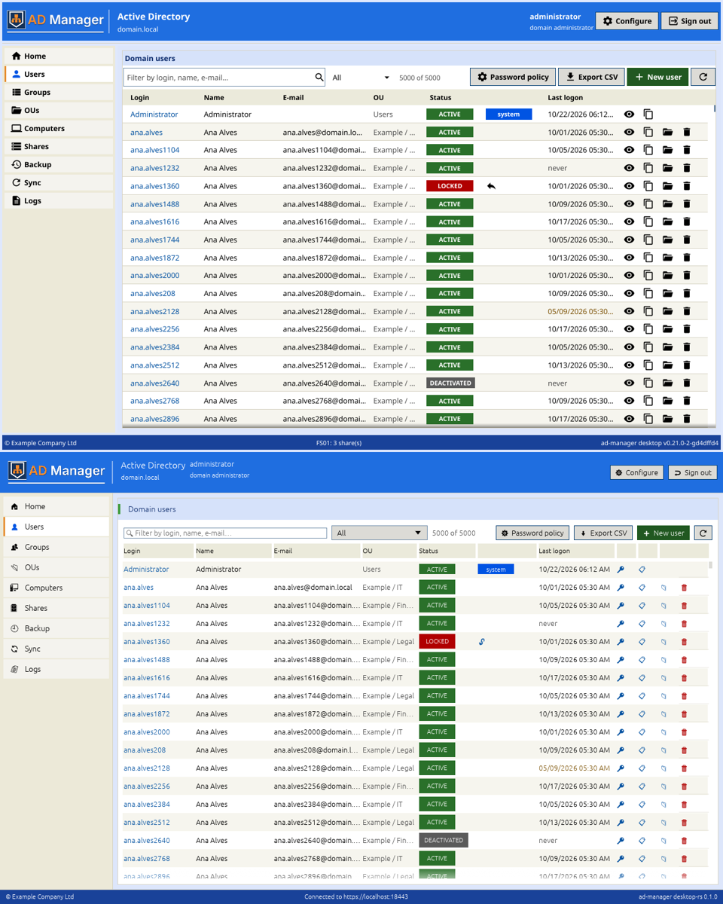

# Benchmark: Rust (egui) vs Fyne (Go)

The question of this app: is an immediate-mode Rust GUI faster than the Fyne desktop at the same job? Both apps
were run on the same machine, the same X server and the same mock panel, with release builds, and driven the same
way. The method is the OpenSpec change's ([design.md](../../openspec/changes/desktop-rust/design.md#benchmark-method));
the script is [bench/run.sh](../bench/run.sh) (`make bench`).

## Result

Median of 5 runs per app (one warm-up run each first, discarded), runs alternating Fyne / Rust, 5,000 users. The Rust
app was measured twice: with the **wgpu** renderer it ships (design D12: the crash-safe graphics start needs it; here
wgpu's OpenGL backend on llvmpipe, `WGPU_BACKEND=gl`, as `--gpu-info` reported `wgpu Gl Cpu llvmpipe`) and, earlier,
with the **glow** renderer (eframe's plain OpenGL, now used only on macOS). Each measurement has its own Fyne runs from
the same session: the machine was busier during the wgpu one (Fyne's own start went from 118 to 166 ms), so compare
within a table, not across them.

**wgpu build (shipped)**, 2026-10-23:

| Metric | Fyne (Go) | egui (Rust, wgpu) | Rust vs Fyne |
|---|---:|---:|---:|
| Binary size, stripped (MiB) | 25.7 | 26.4 | +3% |
| Cold start to the sign-in window (ms) | 166 | 139 | 1.2× faster |
| Idle memory at sign-in, PSS (MiB) | 196.5 | 128.2 | −35% |
| Sign-in to the Users page with 5,000 users (ms) | 1485 | 852 | 1.7× faster |
| Memory with 5,000 users on screen, PSS (MiB) | 238.3 | 141.7 | −41% |
| CPU for 200 wheel steps on the table, all threads (ms) | 17840 | 22420 | +26% |
| Wall time of the 200 wheel steps until idle (ms) | 24591 | 24479 | same (paced by the script) |

**glow build** (before D12):

| Metric | Fyne (Go) | egui (Rust, glow) | Rust vs Fyne |
|---|---:|---:|---:|
| Binary size, stripped (MiB) | 25.7 | 21.0 | −18% |
| Cold start to the sign-in window (ms) | 118 | 64 | 1.8× faster |
| Idle memory at sign-in, PSS (MiB) | 186.8 | 95.2 | −49% |
| Sign-in to the Users page with 5,000 users (ms) | 1469 | 853 | 1.7× faster |
| Memory with 5,000 users on screen, PSS (MiB) | 234.0 | 111.3 | −52% |
| CPU for 200 wheel steps on the table, all threads (ms) | 22600 | 19580 | −13% |
| Wall time of the 200 wheel steps until idle (ms) | 24573 | 24448 | same (paced by the script) |

**The Rust app starts sooner, uses a third to a half less memory and reaches the populated Users page 1.7× faster
with either renderer**, and its times are steadier (sign-in to Users: 846–856 ms in every run of both builds; Fyne: 937 to 1519 ms).
**wgpu costs** about 33 MiB of memory, ~70 ms of start (the instance and adapter setup), 5 MiB of binary and, on this
software path, more CPU while scrolling than glow — enough to fall behind Fyne's scroll CPU in this session. That is
the price of the crash-safe start (several backends, adapter choice, WARP on GPU-less Windows); on a real GPU wgpu
uses Vulkan, DX12 or Metal, where rendering is not the CPU's work.



## Machine and builds

| | |
|---|---|
| CPU | AMD Ryzen 9 9900X, 12 cores / 24 threads |
| Memory | 186 GiB |
| OS | Linux 6.8 (Ubuntu 24.04, glibc 2.39) |
| Display | Xvfb 1920×1080×24, 96 dpi, Mesa llvmpipe (software OpenGL) for both, scale 1 |
| Fyne app | `dist/desktop/linux-amd64/ad-manager-desktop` v0.21.0-2-gd4dffd4 (Go, Fyne, release build) |
| Rust app | `ad-manager-desktop-rs` 0.1.0 (Rust 1.99, eframe 0.36, `lto = "thin"`, stripped): wgpu 30 with `WGPU_BACKEND=gl` (`--gpu-info`: `wgpu Gl Cpu llvmpipe (LLVM 20.1.2, 256 bits)`), and earlier glow |
| Panel | the mock panel of this repository (`crates/core/examples/mock_panel.rs`), HTTPS self-signed, pinned |

Raw numbers (`target/bench/<date>/raw.txt` of a run), wgpu build:

```
app run cold_ms idle_pss_mib signin_to_users_ms users_pss_mib scroll_cpu_ms scroll_wall_ms
fyne 1 166 196.5 1445 238.8 21590 24607
rust 1 135 128.2 856 142.4 23470 24479
fyne 2 166 196.4 1500 234.0 17840 24591
rust 2 153 128.4 852 140.9 22260 24468
fyne 3 176 200.2 1492 235.8 17070 24523
rust 3 143 128.1 846 142.5 19890 24597
fyne 4 169 198.9 1485 238.3 20690 25210
rust 4 139 128.5 851 140.9 22420 24483
fyne 5 162 196.5 1467 238.7 17730 24553
rust 5 134 128.2 854 141.7 23400 24466
```

glow build:

```
app run cold_ms idle_pss_mib signin_to_users_ms users_pss_mib scroll_cpu_ms scroll_wall_ms
fyne 1 115 186.4 1499 239.1 22890 24557
rust 1 64 95.2 853 111.3 19290 24450
fyne 2 118 173.2 1463 234.0 22600 24715
rust 2 62 95.2 853 110.9 19580 24439
fyne 3 115 186.8 937 234.7 25050 29187
rust 3 68 95.3 854 112.0 19850 24448
fyne 4 120 186.9 1519 232.4 18370 24573
rust 4 66 95.1 853 111.3 19660 24444
fyne 5 119 192.9 1469 230.9 18970 24558
rust 5 64 95.3 853 112.0 19230 24453
```

Every run also keeps a screenshot of the sign-in window, of the Users page and of the scrolled table for each app
(`target/bench/<date>/`): both apps show the same accounts in the same 1280×800 window, and the scroll check
compares the table before and after.

## How it is measured

- **Readiness** is the same for both: the mock panel has answered the request a step waits for (the summary for Home,
  the second list of users for the Users page), then the process's CPU time has not moved for 300 ms. The sign-in
  window is measured when it maps (its blinking caret is never idle); a step not ready in 30 s fails the run.
- **Sign-in to Users** covers the same work for both: Enter on the password, Home ready, a click on Users, the
  5,000-row list ready. The Fyne shell builds and loads every page at sign-in; the Rust shell loads Home at sign-in
  and Users when it opens (the interval covers both ways).
- **Memory** is the process's PSS (`/proc/<pid>/smaps_rollup`) 3 s after the step.
- **Scroll**: 200 mouse-wheel steps over the table, 20 ms apart, then the idle rule; CPU is user + system time of all
  the process's threads (Mesa's rendering threads included).

## What made the difference in the Rust app

Two changes, both in the app, brought the scroll CPU below Fyne's (the first measurement was 2.3× Fyne's):

1. **Frames paced at 60 per second.** Without vsync (Xvfb here; also VMs and remote desktops) egui draws as fast as it
   can while something animates. The app now waits so two frames are at least 16.6 ms apart — what a display with
   vsync already does.
2. **A wheel notch scrolls in one frame.** X11 and Windows wheels report "lines"; egui spreads each over several
   frames, every one a full redraw. The app hands a notch to egui as the small steps a touchpad sends, which egui
   applies at once; floating scroll bars (which fade in and out) and widget animations are off.

## Limits

- **Fresh state per run.** Each run has its own `HOME` and `XDG_*` folders (and the Rust app its own config folder), so
  neither app's saved window, preferences or graphics choice carries over between runs.
- **Software rendering.** Both apps rendered with llvmpipe on Xvfb: the benchmark needs a display it can drive with
  `xdotool` without touching the operator's screen. On a GPU, rendering costs both apps less CPU; egui redraws the
  whole window on every input frame (a mouse move over the window costs ~30 ms of CPU here; Fyne redraws only what
  changed), which a GPU makes cheap.
- **Linux only.** Windows and macOS builds are produced by the release workflow but were not measured.
- **The Fyne binary** is the one in `dist/` of the monorepo (v0.21.0 + the next commit); 0.22.0 only adds a group count
  to a dialog and a framework update, nothing on the measured paths.
