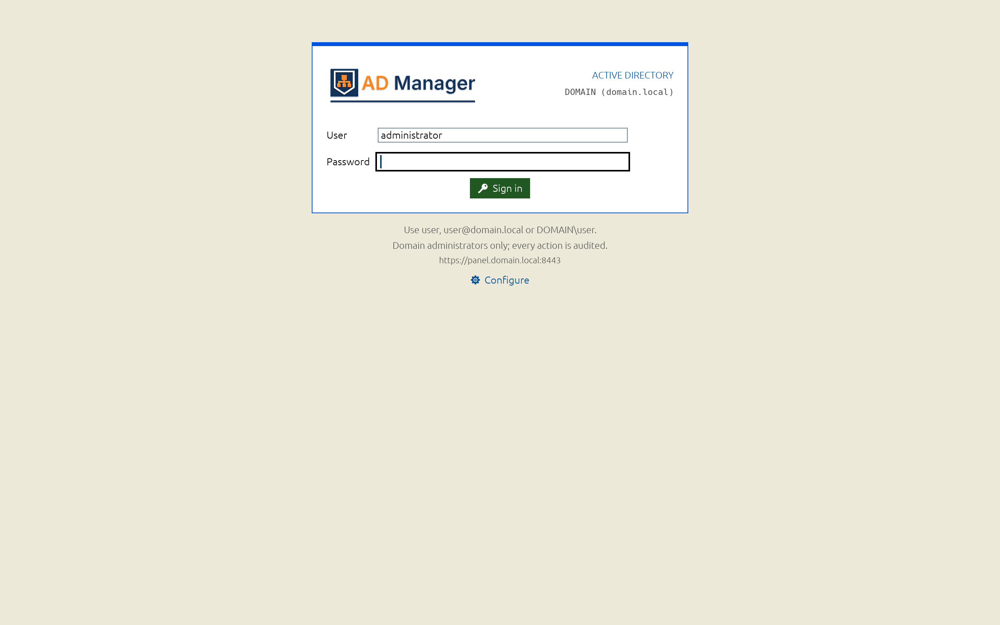

# AD Manager desktop (Rust)

The desktop client of the [ad-manager](../README.md) panel, written in Rust with
[egui/eframe](https://github.com/emilk/egui), matching the web panel's pages, themes and rules (user guide:
[docs/desktop.md](../docs/desktop.md)). It replaced the Fyne desktop, now archived in [`archive/desktop-go/`](../archive/desktop-go) as code
only; the benchmark that compared them is in [docs/benchmark.md](docs/benchmark.md). It has the server's version and
is released with it (tags `vX.Y.Z`).

| Sign-in | Users |
|---|---|
|  |  |

## What it does

The web panel's pages and dialogs, laid out as the web's, against the same panel API and with the same rules (the
server stays the authority):

- **Configure**: panel URL, user, password and language; **Test connection** reads the certificate, the health and
  signs in for real. A self-signed certificate is shown (fingerprint, subject, issuer, validity) and trusted only
  when the operator clicks **Trust this certificate**; from then on only that certificate is accepted (its
  handshake signed with its key). Redirects are never followed. The password is never saved.
- **Sign-in** like the web one (dots, box, language switch), with the panel's theme, logo and domain; then the web's
  shell (header with the global search, top tabs, footer) and its pages: **Home**, **Users**, **Groups**, **OUs**
  (with GPOs), **Computers** (with DNS and SMB sessions), **Shares** (file servers, tasks, sessions, the share form
  with the folder's permissions), **Import/export** (CSV, another AD, folders, each previewed as a plan),
  **Backup** (schedules edited in place), **Sync** (the wizard with its preview step, runs, quarantine), **Logs**
  (audit, HTTP, Samba) and **Settings** (language, theme, company, logo, agent token), with the web's dialogs and
  guards (built-in and own accounts, DCs, typed confirmations).
- It talks **only to the panel**: file servers through the panel's proxy, never with an agent token.
- **`desktop.toml`** (the keys and lookup of the archived Fyne app: `--config`, `AD_MANAGER_DESKTOP`,
  `.config/desktop.toml` beside the executable, the user config folder), written `0600` and refused when looser.
- English interface with the pt-BR catalog (`crates/core/assets/i18n/pt-BR.json`); server messages translated with
  the panel's catalog (`/api/i18n`).
- The panel's 18 themes (`crates/core/assets/themes.json`, generated from the web's CSS by
  `archive/desktop-go/internal/themegen`), drawn with their gradients, shadows, fonts and the page's pattern, or flat.
  **Configure › Appearance** picks another theme (and flat or with depth) for this computer only, applied at once
  and saved as `[appearance]` in desktop.toml; *Panel default* follows the panel's Settings.
- A **crash-safe graphics start** (rustXterm's design). The app renders through wgpu. Before the window opens it
  takes a `gpu-starting` marker next to desktop.toml, and a start that dies in the graphics driver makes the next
  start try a safer backend:
  - Windows: OpenGL → DirectX 12 → Vulkan → software (WARP);
  - Linux: Vulkan → OpenGL → software (llvmpipe);
  - macOS: Metal → OpenGL (glow).

  A working fallback is saved as `[graphics]` in desktop.toml and announced under the sign-in
  box. It can be changed in **Configure › Graphics › Rendering backend**, which applies at the next start. Choices:
  - Automatic;
  - **wgpu (WebGPU)**, where wgpu picks the backend and the adapter itself: on Windows it prefers DX12/Vulkan, where
    Automatic prefers OpenGL;
  - the OS's backends (Vulkan, OpenGL, DirectX 12, Software). Flags and variables:
  - `--safe-gpu` forces the software path for one start;
  - `WGPU_BACKEND` forces wgpu's own choice;
  - `--gpu-info` prints the backend and adapter used.

  The window is 1280×800 (minimum 800×600) and eframe restores its size and position.

## Layout

A Cargo workspace, laid out as [rustXterm](https://github.com/jniltinho/rustXterm):

| Crate | Job |
|---|---|
| `apps/ad-manager-desktop` | the binary: arguments, picks the platform, starts eframe |
| `crates/ui` (`adm-ui`) | egui: screens, pages, dialogs, the table, theme → visuals |
| `crates/core` (`adm-core`) | no GUI: config, panel client, TLS pinning, i18n, theme data, models, page rules, form payloads |
| `crates/platform` (`adm-platform`) | the `Platform` trait (config locations, private files) and the Unix helpers |
| `crates/platform-linux`, `-windows`, `-macos` | one implementation each |

Requests run on a tokio runtime off the UI thread; each ends by sending a closure back to the UI thread over a
channel (only the UI thread changes UI state; a result of a replaced session or of an older reload is dropped).
`unsafe` is forbidden and `unwrap`/`expect` are denied by the workspace lints; passwords are wiped from memory after
use (`zeroize`).

## Build and test

Everything runs in Docker (the pinned rustXterm toolchain image, and the Go image for the theme generator); the host
needs neither Rust nor Go. From the repository root: `make desktop`, `make desktop-check`, `make desktop-shots`,
`make desktop-themes`; here:

```bash
make check     # fmt, clippy -D warnings, unit + UI acceptance tests, cargo deny, themes.json in step with the CSS
make release   # target/docker/release/ad-manager-desktop
make dist      # Linux tar.gz and Windows zip in dist/
make shots     # the docs screenshots (2x, Classic blue, domain.local)
make mock      # a mock panel with 5,000 users (prints the URL and pin for desktop.toml)
make bench     # the benchmark against the archived Fyne app
```

Against a real domain, the all-in-one test image ([docs/docker.md](../docs/docker.md), a fictitious `domain.local`
with its LDAPS and panel on `127.0.0.1` only) runs the ignored live test: it signs in, opens every page and tab, fails
on any error and saves a screenshot of each. The password stays in a 0600 file outside the repository; never point it
at a production panel.

```bash
DESKTOP_RUST_DOCKER_NET=host DESKTOP_RUST_DOCKER_ARGS="-v $HOME/.adm-live:/live:ro" scripts/cargo-docker.sh sh -c 'ADM_LIVE_URL=https://127.0.0.1:18443/ ADM_LIVE_PASSWORD_FILE=/live/password ADM_LIVE_SHOTS=/work/desktop/target/live cargo test -p adm-ui --test live -- --ignored'
```

macOS builds natively on a Mac (`rustup` reads `rust-toolchain.toml`): `cargo build --release` and
`packaging/macos/bundle.sh` for the universal `.app`. Its CI (`.github/workflows/desktop-ci.yml`) is part of
`ci.yml`, with the server's; the release (`release.yml`, tags `vX.Y.Z`) builds its Linux, Windows and macOS universal
archives and publishes them with the server's packages, one `checksums.txt` and the notes of the root
[CHANGELOG.md](../CHANGELOG.md).

The OpenSpec change is [openspec/changes/desktop](../openspec/changes/desktop/) (parity matrix and
benchmark method in its `design.md`).
