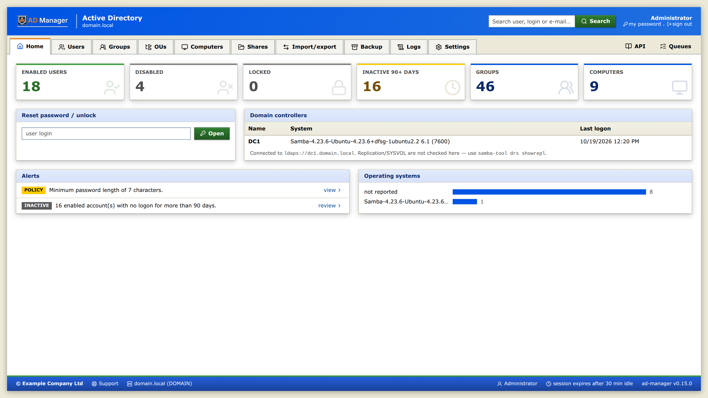
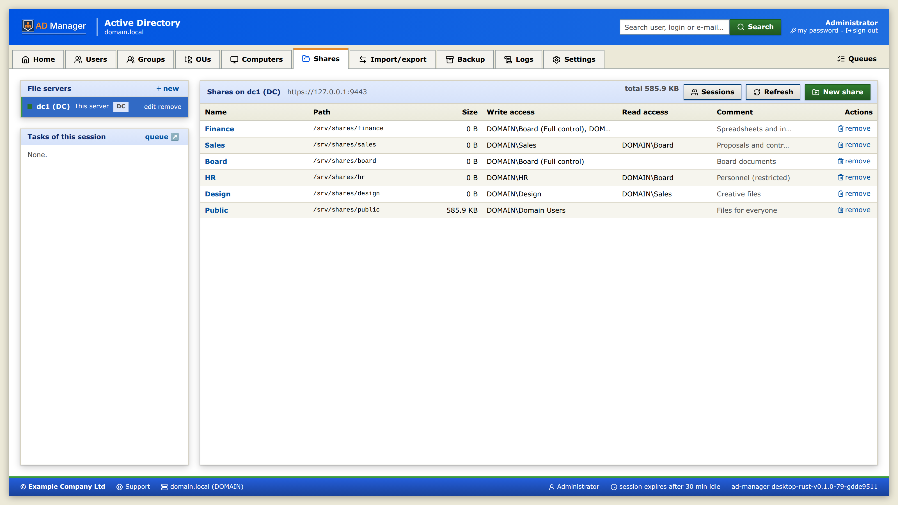
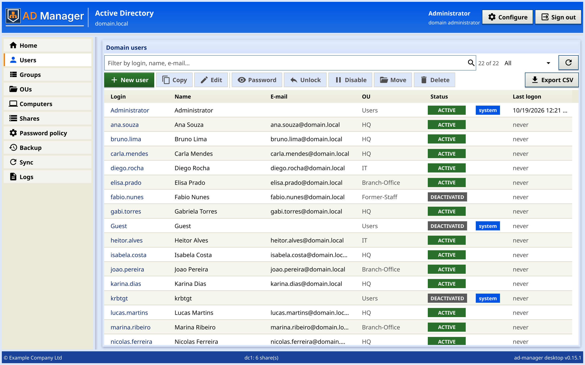
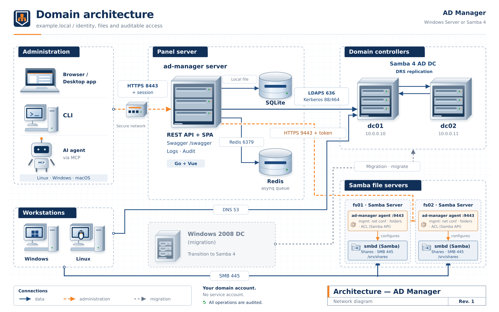
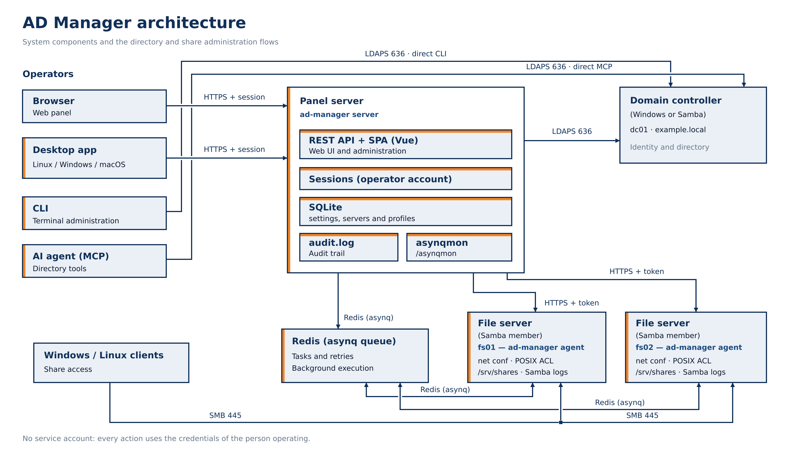
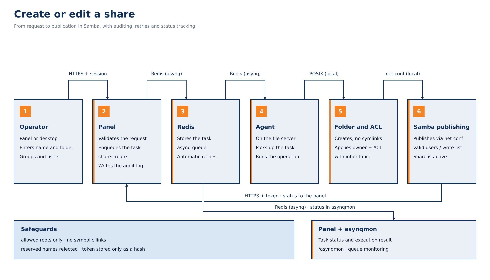
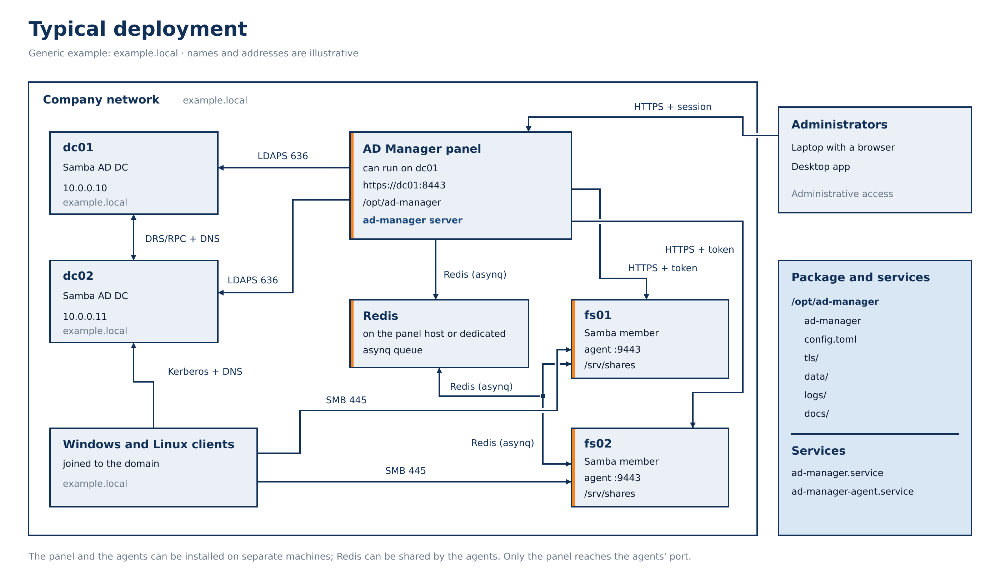

# AD Manager documentation

**AD Manager** manages an Active Directory — Windows Server or Samba 4 — through a **web panel**, a
**desktop app** and a **CLI**, with an **MCP server** for AI agents and an **agent** that creates folders and
shares on Samba file servers. It works with any domain, including during the migration of a Windows DC to
Samba 4.23 on Ubuntu 26.04: everything comes from `config.toml` and the **Settings** screen.

## Where to start

| I want to… | Read |
|---|---|
| See what it does (features, screenshots, architecture) | [overview.md](overview.md) |
| Try it without preparing a server (Docker: Samba domain with panel and agent) | [docker.md](docker.md) |
| **Install on a server — automatic setup in the browser (recommended)** | [installation.md](installation.md) |
| Install, upgrade or remove the panel, the agent or the desktop app (`.deb` or binary), with every config key | [install-guide.md](install-guide.md) |
| Install and configure the panel by hand (`.deb` package, services, TLS, existing AD) | [deployment.md](deployment.md) |
| Set up a new Samba domain, an additional DC or a file server from the command line | [samba-install.md](samba-install.md) |
| Migrate a Windows DC to Samba (cutover, gates, rollback) | [migration-runbook.md](migration-runbook.md) |
| Preserve the users' passwords on a new-domain cutover | [password-migration.md](password-migration.md) |
| Create folders and shares on the file servers | [agent.md](agent.md) |
| Use Samba as DC and file server on the same machine | [dc-file-server.md](dc-file-server.md) |
| Bring folders over from another server (SMB) and restore files from quarantine | [sync.md](sync.md) |
| Use the app on my machine (Linux, Windows, macOS) | [desktop.md](desktop.md) |
| Automate from the terminal | [cli.md](cli.md) |
| Connect an AI agent (Claude, Codex…) to AD | [mcp.md](mcp.md) |
| Understand how it works inside | [architecture.md](architecture.md) |
| Build, test and release a version | [development.md](development.md) |
| Know which libraries are vendored in the project (`third_party/`) and why | [vendor.md](vendor.md) |
| Take the look (web and desktop) to another system | [themes.md](themes.md) |
| See the screens | [screenshots/](screenshots/README.md) |

## Components

| Component | What it is | Where it runs |
|---|---|---|
| **Web panel** (`ad-manager server`) | Go (Echo v5) + embedded Vue 3/Tailwind SPA; HTTPS; session with the operator's account | server (can be the DC itself) |
| **CLI** (`ad-manager …`) | Cobra; everything the panel does, plus migration and export/import | any machine with LDAPS access |
| **MCP** (`ad-manager mcp`) | MCP server (stdio) for AI agents; read-only by default | operator's machine |
| **Agent** (`ad-manager agent`) | HTTPS API with token + asynq/Redis queue; folders, ACLs and shares (`net conf`) | each Samba file server (or the DC that also serves files) |
| **Desktop app** (`ad-manager-desktop`) | Fyne; uses the panel's API and, for shares, the agent directly | operator's machine |
| **Samba installer** (`scripts/samba-setup.py`) | new domain, additional DC or file server, with the panel or the agent already configured | Ubuntu 26.04 servers |

A single binary (`ad-manager`) provides the panel, CLI, MCP and agent; the `.deb` package installs everything in
`/opt/ad-manager`.

## What you can do

| Area | Panel | Desktop | CLI | MCP |
|---|:-:|:-:|:-:|:-:|
| Users: list, filter, create, copy as template, edit, move, delete | ✔ | ✔ | ✔ | ✔ |
| Password: reset with generator, change at next logon, unlock; change your own | ✔ | ✔ | ✔ | ✔ |
| One-time link for the user to choose the new password | ✔ | ✔ | — | ✔ |
| Enable/disable accounts (by clicking the status, in the panel) | ✔ | ✔ | ✔ | ✔ |
| Groups and members, OUs, computers | ✔ | ✔ | ✔ | ✔ |
| Domain password policy | ✔ | ✔ | ✔ | ✔ |
| CSV export/import (users, groups, OUs, computers, folders) | ✔ | CSV | ✔ | — |
| Import directly from another AD | ✔ | — | `export` + `import` | — |
| Folders and shares (create, edit, remove, size) | ✔ | ✔ | `migrate shares` | — |
| Migration: preflight, inventory, diff, Windows shares | — | — | ✔ | preflight |
| Logs: audit and Samba (from the DC and from each file server) | ✔ | ✔ | — | ✔ |
| Agent queues (asynqmon) | ✔ | — | — | — |
| Company settings (language, session, logo, support link…) | ✔ | — | — | — |

## Two-layer configuration

- **`/opt/ad-manager/config.toml`** — what requires a restart: DC (`[ad]`), panel address and TLS (`[server]`),
  local database (`[db]`), queue (`[redis]`), agent (`[agent]`) and Samba logs (`[samba]`). `AD_*` variables
  override it. Commented example in [`config.toml.example`](../config.toml.example).
- **Settings screen** (panel) — what changes without a restart and is stored in SQLite: default language, session
  timeout, days until an account counts as inactive, generated password length, default OU for new users and
  company identity (name, support link, logo).

## Security, in short

- There is no service account: every action uses the credentials of whoever is operating (LDAPS; writes only over
  TLS).
- Only *Domain Admins* can log in (checked by SID, or `admin_group`); 5 failures in 5 minutes block the IP.
- Protections on the server, not just in the UI: built-in accounts and groups (RID < 1000), domain controllers and
  the operator's own account cannot be deleted or disabled; deletion requires typing the name.
- Password change link: one-time use, only in the first browser that opens it, with an expiry; the panel stores only
  the token hash and the temporary password encrypted with a key derived from it.
- Every change goes to `audit.log` (JSON, no passwords), visible on the **Logs** screen.
- The agent only accepts a token (stored as a hash), only touches the configured roots and does not follow symbolic
  links.

Details in [architecture.md](architecture.md).

## Screens

| Home | Users |
|---|---|
|  |  |

| Shares | Desktop app |
|---|---|
|  |  |

All screens, web and desktop: [screenshots/README.md](screenshots/README.md).

## Diagrams

| Architecture | Creating or editing a share |
|---|---|
|  |  |

| Typical deployment |
|---|
|  |

The test labs (Windows and Samba, isolated) are in [labs.md](labs.md).

SVG sources in [`img/`](img/); logo in `img/logo.svg` and `img/logo/` (flat). The raised logos of the web panel, the desktop app and the README banner (`img/logo-wide.*`) come from `scripts/logo-relief.py`.

## Reference

- [samba-api.md](samba-api.md) — Samba 4 API in the agent: Windows permissions on folders (implemented) and next
  phases.
- [samba-bridge.md](samba-bridge.md) — how the agent reads and writes to Samba: persistent Python helper, reading
  the Windows ACL in Go (rules and diagrams) and the parity tests.
- [gpo.md](gpo.md) — study of GPOs (Group Policy) with the Samba API, for the future.
- [`openspec/`](../openspec/) — proposals, specs and tasks for each change.
- [`CHANGELOG.md`](../CHANGELOG.md) — what changed in each version.
