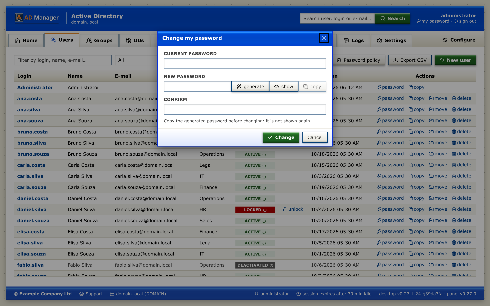
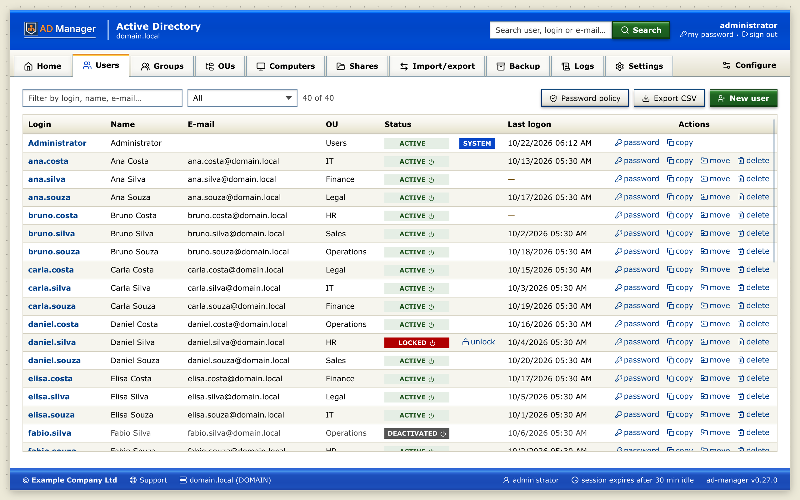
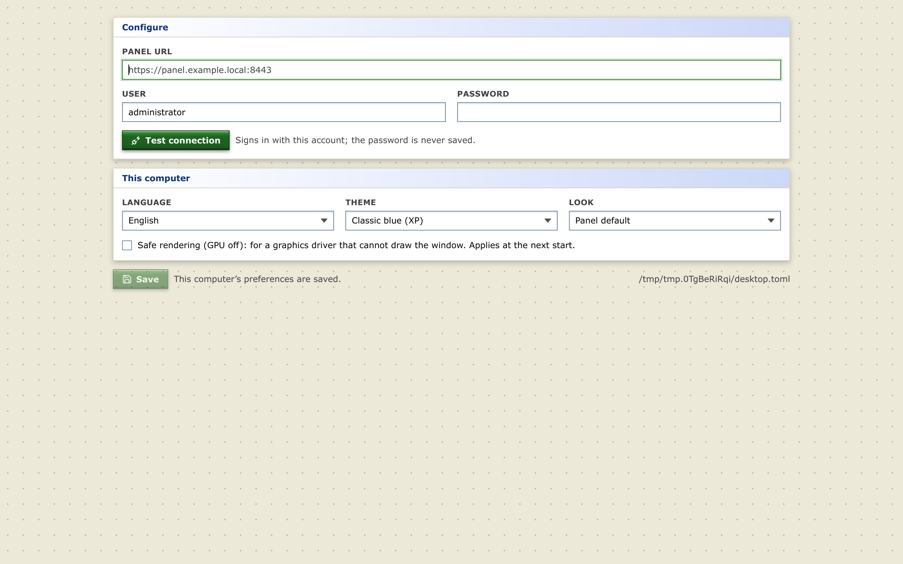
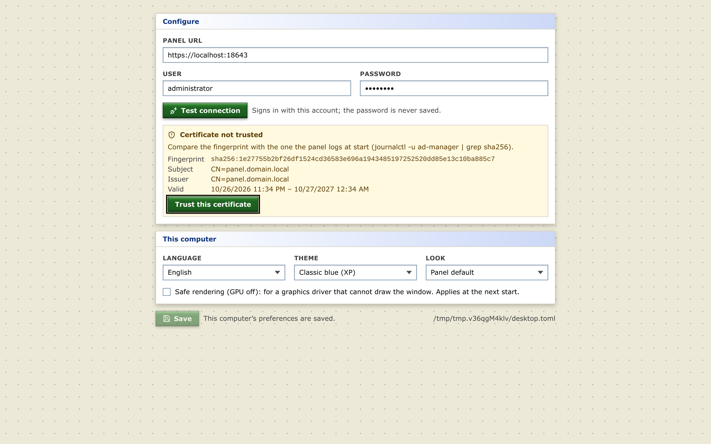

# Desktop app

For the manager to use on their own machine (Linux, Windows or macOS), without a browser. It is the web panel itself
in a native window: Go with [Wails v3](https://wails.io) ([`desktop/`](../desktop/README.md)) runs the panel's own
pages in the system's webview. It is a client of the **panel API** only (sign-in with the domain account, same rules —
*Domain Admins* only, audit with the machine's IP): the file servers' shares and Samba logs go through the panel's
proxy to each agent too, so the desktop needs only the panel's port and never holds an agent token.

| Sign-in | Users |
|---|---|
|  |  |

More screens in [screenshots/](screenshots/README.md#desktop-app).

## What it does

Everything the web panel does, with its pages, dialogs, guards, the 20 themes (flat or with depth) and both languages,
because it is the same code: **Home**, **Users**, **Groups**, **OUs** (with GPOs), **Computers**, **Shares**,
**Import/export**, **Backup** and **Sync**, **Logs** and **Settings**. On top of the web panel:

- **Configure** (first run, the sign-in box and the tab bar, next to Queues): the panel, the account and this computer's preferences.
- **The panel's certificate is pinned**: a self-signed one is accepted only after the operator trusts its
  fingerprint, and then only that certificate. A redirect is never followed, and only `https://` is used.
- **The session stays in the app**: the panel's session cookie is kept in Go and never reaches the page. Nothing of
  an ended session (a late answer, a late error) reaches the next one.
- **Files go straight to disk**: exports, backups and GPO backups are saved through a native dialog, readable by
  their owner only (Linux, macOS). Backups are sent from disk with progress and a stop button.
- **This computer's look**: the theme, flat or with depth, and the language can differ from the panel's.
- **Its own window**: remembered size and place, one window per configuration file, the app's icon. The panel's
  API docs open in the system browser; the queue monitor is off (Queues shows disabled: it needs a browser session
  to the panel).

## Configure

On first run the app opens the **Configure** screen: panel URL, user and password. **Test connection** reads the
panel's certificate, checks its health and signs in with that account (*Domain Admins*). It shows the domain, the
user and the panel version, or the panel's reason (wrong password, not a Domain Admin, panel being set up). **Save**
is enabled after a successful test of the values on screen. It writes the configuration and opens the app already
signed in, without asking for the password again. The password is used only for the test and is never saved.



**Self-signed certificate.** When this computer does not trust the panel's certificate (a fresh installation's own),
Test shows its SHA-256 fingerprint, subject, issuer and validity. Compare the fingerprint with the panel's (the panel
logs it at start: `journalctl -u ad-manager | grep sha256`) and click **Trust this certificate**. From then on only
that certificate is accepted (`fingerprint` in the file). A renewed or replaced certificate is refused until it is
trusted again in **Configure**.



**This computer**: language, theme, look (flat or with depth) and **safe rendering** (the GPU off, for a graphics
driver that cannot draw the window; also `--safe-gpu`, on Linux and Windows). They are saved as they change, without a
test, even before the panel is configured or when it cannot be reached.

On save it writes **`.config/desktop.toml` in the executable's folder** (permission `0600`). This way each copy of
the app carries its own configuration, even on a USB stick. If the file has looser permissions, the app shows why in
Configure and does not overwrite it. Lookup order:

1. `ad-manager-desktop --config /path/desktop.toml`
2. variable `AD_MANAGER_DESKTOP=/path/desktop.toml`
3. `.config/desktop.toml` next to the executable
4. the user's configuration folder: `~/.config/ad-manager/desktop.toml` (Linux),
   `~/Library/Application Support/ad-manager/desktop.toml` (macOS), `%AppData%\ad-manager\desktop.toml` (Windows)

If the executable's folder is not writable (`Program Files`, `/usr/bin`) or in the macOS `.app`, the new file goes to
the location of item 4. On Windows the permission follows the folder's: keep the app in a folder of your own. The file
is the one the earlier desktop apps used: a `desktop.toml` of the Rust app opens as is, and its other keys are kept.

```toml
lang = "en"               # "pt-BR" or "en"; left out = the panel's default

[panel]
url = "https://panel.example.local:8443"
fingerprint = "sha256:…"  # only for a self-signed certificate, written by Configure
user = "administrator"    # the password is asked on sign-in and stays only in memory

[appearance]              # this computer's look; left out = the panel's
theme = "classic-blue"
flat = "depth"            # "flat" or "depth"

[graphics]
safe = true               # safe rendering: the GPU off
```

**File servers.** They are registered in the panel (**Shares → File servers → + new**, with the agent's token); the
desktop lists them from the panel.

## Requirements

- **Linux**: an x86_64 desktop with glibc 2.39 or later (Ubuntu 24.04+, Debian 13+, Fedora 40+, RHEL 10+). The
  AppImage carries GTK4 and WebKitGTK 6.0; the system gives the graphics drivers (Mesa) and WebKit's sandbox,
  `bubblewrap` and `xdg-dbus-proxy`, which GNOME and KDE desktops have (else `sudo apt install bubblewrap
  xdg-dbus-proxy` or `sudo dnf install bubblewrap xdg-dbus-proxy`). The sandbox needs unprivileged user namespaces,
  which desktop distributions allow.
- **Windows**: 10 or 11 (Windows Server 2025 too), with the WebView2 runtime. Windows 10/11 have it; on Windows
  Server 2016–2022 install it from Microsoft first.
- **macOS**: 12 or later (a universal `.app`, Apple Silicon and Intel).

## Build

The Go builds run in Docker (`desktop/docker/Dockerfile`: Go, GTK4, WebKitGTK 6.0); the SPA builds with the host's npm,
as the server's.

```bash
make desktop          # Linux AppImage, Windows zip and the Linux binary in dist/desktop/
make desktop-check    # gofmt, go vet, Go tests, and the web build without the desktop's code
make desktop-shots    # the docs screenshots (2×, Classic blue, a demo panel; on the host: Xvfb, xdotool)
```

macOS builds on a Mac (see [desktop/README.md](../desktop/README.md)). The desktop app has the server's version and
comes in the same release: a tag `vX.Y.Z` (`release.yml`) publishes `ad-manager-desktop_X.Y.Z_linux_x86_64.AppImage`,
`…_windows_x86_64.zip` and `…_macos_universal.zip` beside the server's packages, with one
`checksums.txt`.

## Earlier desktop apps (archived)

Two earlier desktop apps are kept as code to study only: they are not built, tested or released.
- [`archive/desktop-go/`](../archive/desktop-go/README.md): Go with Fyne.
- [`archive/desktop-rust/`](../archive/desktop-rust/README.md): Rust with egui. It redrew every web page by hand, and
  its benchmark against this app is in [desktop/docs/benchmark.md](../desktop/docs/benchmark.md).
