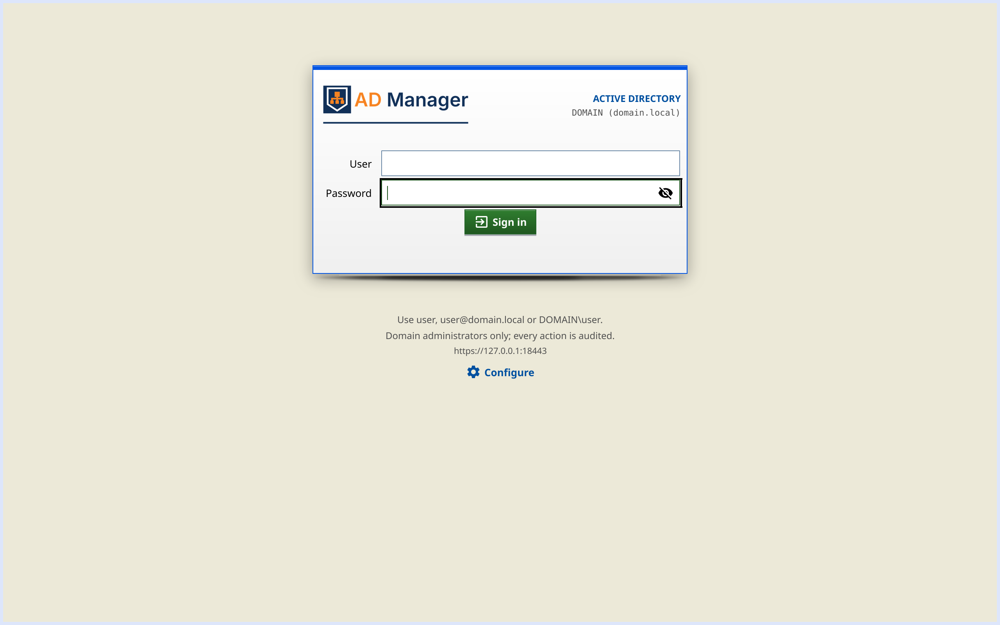

# Desktop app (Fyne)

For the manager to use on their own machine (Linux, Windows or macOS), without a browser. It is a client of the
**panel API** only (sign-in with the domain account, same rules — *Domain Admins* only, audit with the machine's IP):
the file servers' shares and Samba logs go through the panel's proxy to each agent too, so the desktop needs only
the panel's port and never holds an agent token.

| Sign-in | Users |
|---|---|
|  |  |

More screens in [screenshots/](screenshots/README.md#desktop-app).

## What it does

The day-to-day work of the web panel, with the session of your own sign-in (same API, same server protections):

- **Home**: totals (enabled, disabled, locked, inactive, groups, computers), alerts and quick password
  reset/unlock.
- **Users**: filters (all, enabled, disabled, locked, inactive), new and export CSV; each row acts in place, as in
  the web panel — the login opens the edit form (data and groups), the status enables/disables the account, **unlock**
  beside a locked one, and the **password** (a generator or a **single-use link** for the user to choose the new
  one), **copy** (as a template), **move** (to another OU) and **delete** (typing the login) links. Built-in accounts
  and your own have no toggle, move or delete. On a 1280 px window the action links are icons (hovering one names it
  in the status bar); Enter on the selected row opens a menu of its actions.
- **Groups**: new, edit description, delete, members (add/remove).
- **OUs**: list with a readable path, new OU and delete (empty).
- **Computers**: filters (OS, no logon), enable/disable, move, delete and export CSV (DCs protected).
- **Shares**: per server (agent), create, **edit**, remove, folder sizes and total.
- **Password policy**: view and change, from the **Password policy** button of the Users toolbar (as in the web
  panel); Home's policy alert opens it too.
- **Logs**: audit and Samba logs (of this server and of each configured file server).

Import/export and the company **Settings** stay in the web panel only. The interface follows the panel's default
language (or the one chosen in **Configure**).

**Sign-in like the web one**: the 480 px box at 10% of the height, the company logo (an SVG that Fyne cannot draw —
invalid attribute, no size — gives way to the AD Manager one), the error below the box in up to 4 lines (the rest with
an ellipsis), to fit an 800 × 600 window. The window is never narrower than the box with its shadow (532 px), so the
web width rule (window − 32 px) is not needed.

**Same theme as the panel**: the app uses the theme and the flat look chosen in the web panel's **Settings** (the 18
themes). It opens in Default, reads the panel's public theme (`/api/health`) for the sign-in screen and applies the
session's one (`/api/me`) on sign-in; without a response from the panel, it stays in Default. A change in **Settings**
takes effect from the next sign-in. The colors come from the same theme files as the web (`desktop/themes_gen.go`,
generated by `go generate` in `desktop/`; the test fails if it gets out of date). The header uses the web header colors
and the sidebar those of the top tab strip (current item, hover and the theme's accent), with the AD Manager logo in
the right ink; square corners and depth (gradients and shadows), which the flat look turns off. Custom modals
(highlight strip — red for destructive actions —, blurred background) and deletions confirmed by typing the name. The
bevel of Classic gray (98) is drawn with solid strips (the theme's `inset` layers), on buttons, titles and tabs.
Fields, selects and checkboxes show the theme's focus ring outside (3 px in Crystal). Tabs (Logs, user and password
dialogs) follow the theme's tab pattern, like the panel's inner tabs; on Home, alerts show up with a colored tag and a
link to the page that solves them (password policy, users).

Download, install, upgrade and removal on each system: [install-guide.md](install-guide.md#3-desktop-app).

## Configure

On first run the app opens the **Configure** screen: panel URL, user, password and language. **Test connection**
reads the panel's certificate, checks its health and signs in with that account (*Domain Admins*), showing the domain,
the user and the panel version, or the panel's reason (wrong password, not a Domain Admin, panel being set up).
**Save** is enabled after a successful test of the values on screen: it writes the configuration and opens the app
already signed in, without asking for the password again. The password is used only for the test and the session and
is never saved.

**Self-signed certificate.** When this computer does not trust the panel's certificate (a fresh installation's own),
Test shows its SHA-256 fingerprint, subject, issuer and validity. Compare the fingerprint with the panel's (the panel
logs it at start: `journalctl -u ad-manager | grep sha256`) and click **Trust this certificate**: only that certificate
is accepted from then on (`fingerprint` in the file). A renewed or replaced certificate is refused until it is trusted
again in **Configure**. The app never follows a redirect from the panel.

On save, it writes **`.config/desktop.toml` in the executable's folder** (permission `0600`). This way each copy of
the app carries its own configuration, even on a USB stick. To change it later: **Configure** button on the sign-in
screen or in the header (from the header, changing only the language keeps the session). If the file has looser
permissions, the app refuses to open.

Lookup order:

1. `ad-manager-desktop --config /path/desktop.toml`
2. variable `AD_MANAGER_DESKTOP=/path/desktop.toml`
3. `.config/desktop.toml` next to the executable
4. the user's configuration folder, the location used up to 0.3, if it is filled in: `~/.config/ad-manager/desktop.toml`
   (Linux), `~/Library/Application Support/ad-manager/desktop.toml` (macOS), `%AppData%\ad-manager\desktop.toml`
   (Windows)

If the executable's folder is not writable (`Program Files`, `/usr/bin`) or in the macOS `.app`, the new file goes to
the location of item 4. On Windows the permission follows the folder's: keep the app in a folder of your own.

```toml
lang = "en"               # "pt-BR" or "en"; left out = the panel's default

[panel]
url = "https://panel.example.local:8443"
fingerprint = "sha256:…"  # only for a self-signed certificate, written by Configure
user = "administrator"    # the password is asked on sign-in and stays only in memory
```

**File servers.** They are registered once in the web panel (**Shares → File servers → + new**, with the agent's
token); the desktop lists them from the panel. Files written by earlier versions may still list `[[agents]]` with
their tokens: the app ignores them and rewrites the file without them on start (it says so in the status line).
Files with the Portuguese keys (`[painel]`, `usuario`, `idioma`) are still read; saving rewrites them with the keys
above.


## Build

Fyne uses OpenGL via CGO, so the app is a separate Go module (`desktop/`) and the main binary stays static.

```bash
sudo apt install libgl1-mesa-dev xorg-dev libwayland-dev libxkbcommon-dev   # once (Linux)
make desktop          # the three platforms; make build also builds the server
```

The binary is always called `ad-manager-desktop`, one per folder in `dist/desktop/`:

| Platform | File | How |
|---|---|---|
| Linux amd64 | `dist/desktop/linux-amd64/ad-manager-desktop` | native (`make desktop-linux`) |
| Windows amd64 | `dist/desktop/windows-amd64/ad-manager-desktop.exe` | cross-compiled with [zig](https://ziglang.org) (`make desktop-windows`; `ZIG=` if it is not in the PATH) |
| macOS Apple Silicon | `dist/desktop/darwin-arm64/ad-manager-desktop` | on a Mac: `cd desktop && make mac-arm64` |
| macOS Intel | `dist/desktop/darwin-amd64/ad-manager-desktop` | on a Mac: `cd desktop && make mac-amd64` |
| macOS universal | `dist/desktop/darwin-universal/ad-manager-desktop.app` | on a Mac: `cd desktop && make mac` |

The release workflow publishes `ad-manager-desktop_<version>_linux_amd64.tar.gz` and `…_windows_amd64.zip`.

### macOS (Intel and Apple Silicon)

Fyne needs the Apple SDK, which only comes with Xcode. That is why the Mac build runs **on a Mac**, with
`desktop/Makefile` (it needs neither Node nor the frontend):

```bash
xcode-select --install          # once: Command Line Tools (clang, lipo, codesign)
brew install go                 # or the installer from https://go.dev/dl/ (Go 1.27+)
git clone git@github.com:jniltinho/ad-manager.git && cd ad-manager/desktop
make mac                        # Intel + Apple Silicon + universal + .app + zips
```

| Target | Produces |
|---|---|
| `make mac-arm64` | `dist/desktop/darwin-arm64/ad-manager-desktop` (Apple Silicon) |
| `make mac-amd64` | `dist/desktop/darwin-amd64/ad-manager-desktop` (Intel) |
| `make mac-universal` | `dist/desktop/darwin-universal/ad-manager-desktop` (both, via `lipo`) |
| `make mac-app` | `dist/desktop/darwin-universal/ad-manager-desktop.app` with icon, ad-hoc signed |
| `make mac` | all of the above and `dist/ad-manager-desktop_<version>_darwin_{arm64,amd64,universal}.zip` |

Minimum: macOS 12 (`MIN_MACOS=12.0`, the same as Go). The ad-hoc signature is enough on the Mac that built it; to
distribute without the Gatekeeper warning, sign with a Developer ID (`codesign --sign "Developer ID Application: …"`)
and notarize. On a Mac that received the `.app` without an Apple signature: right-click → **Open** the first time.

On GitHub Actions, `ci.yml` runs the same `make mac` on a macOS runner on every push, and `release.yml` attaches the
three zips (arm64, amd64 and the universal `.app`) to each tag's release. On Linux, `make desktop` skips the Mac; it
only builds with the SDK copied from a Mac (`MACOS_SDK=$(xcrun --show-sdk-path)` there, copied here; the Xcode license
does not allow downloading it from anywhere else).
