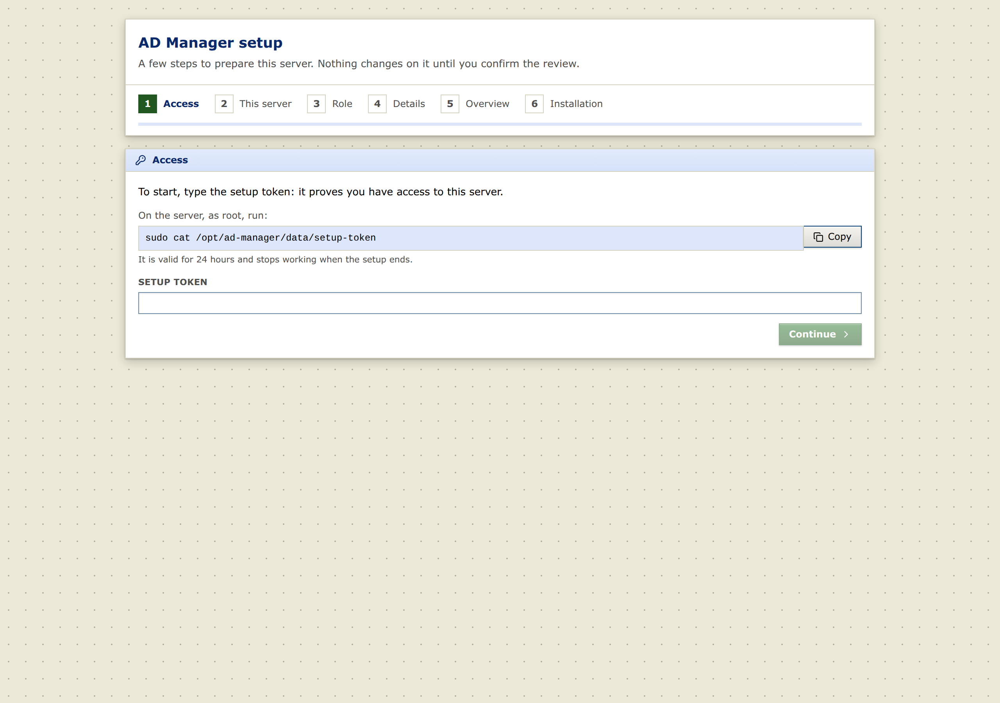
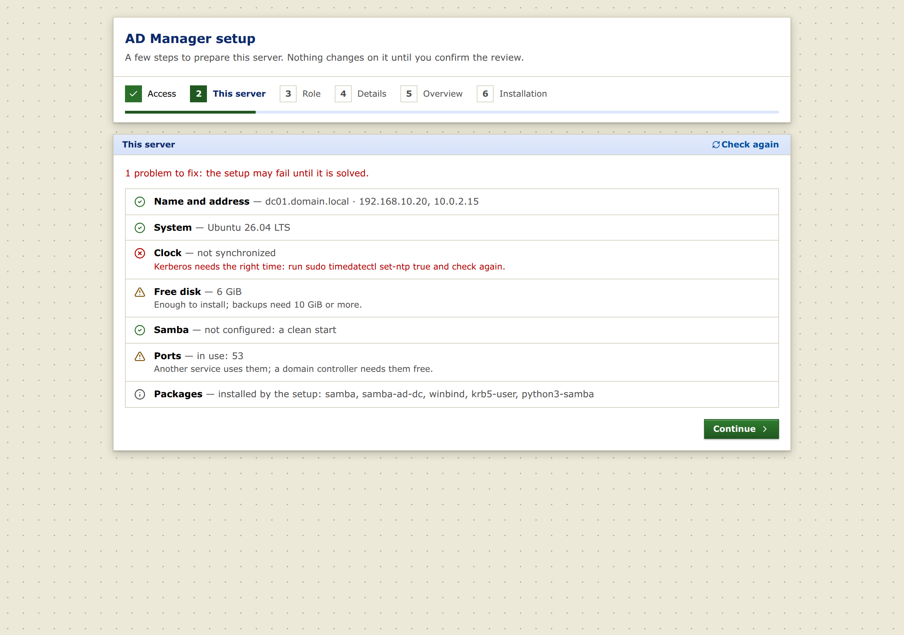
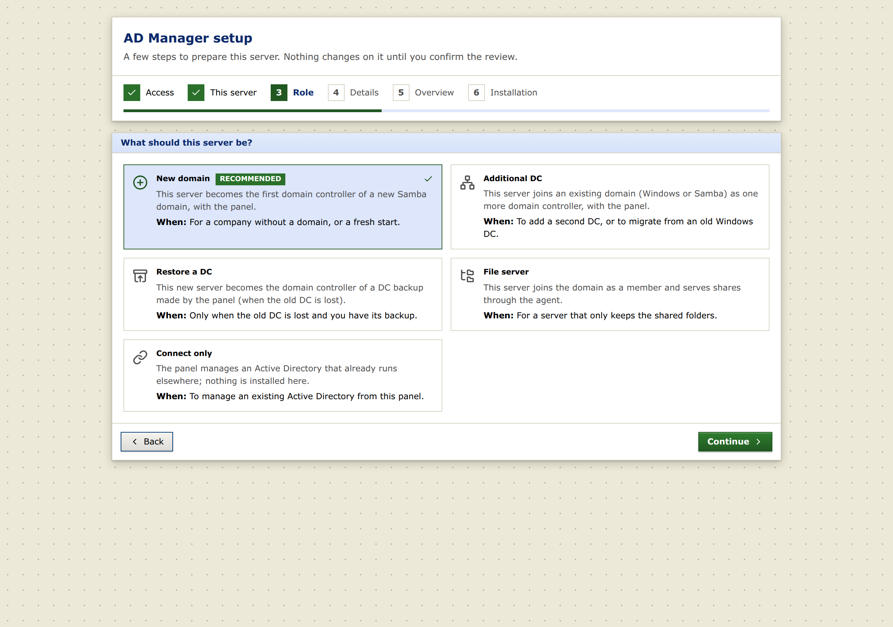
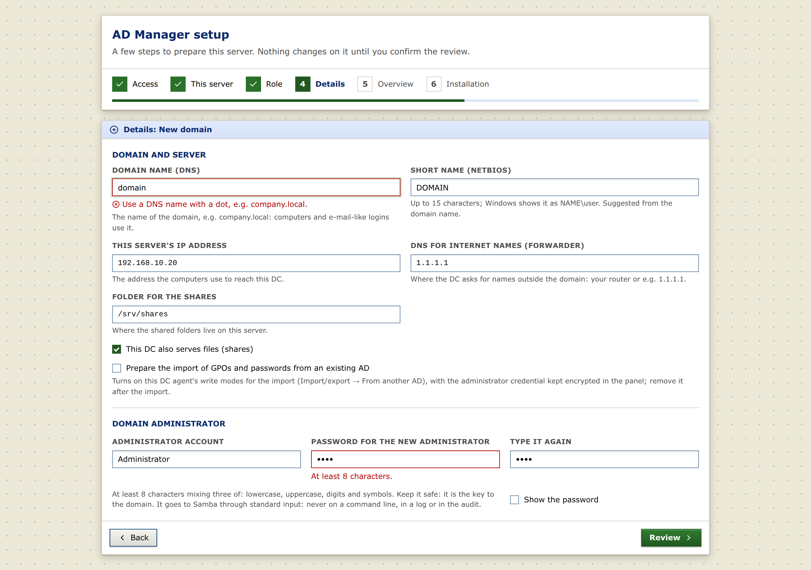
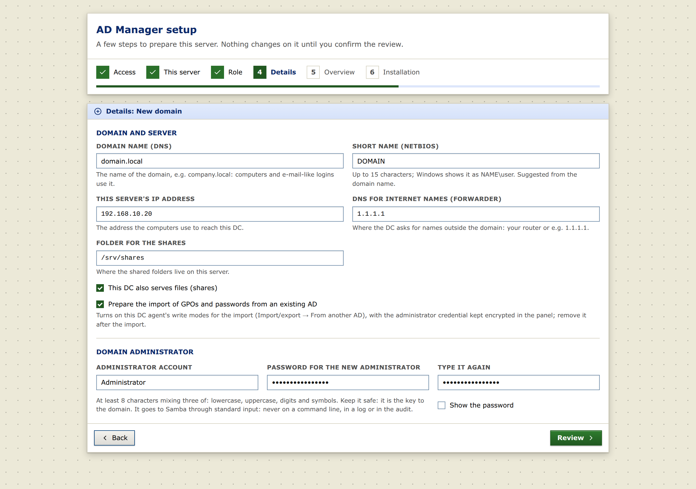
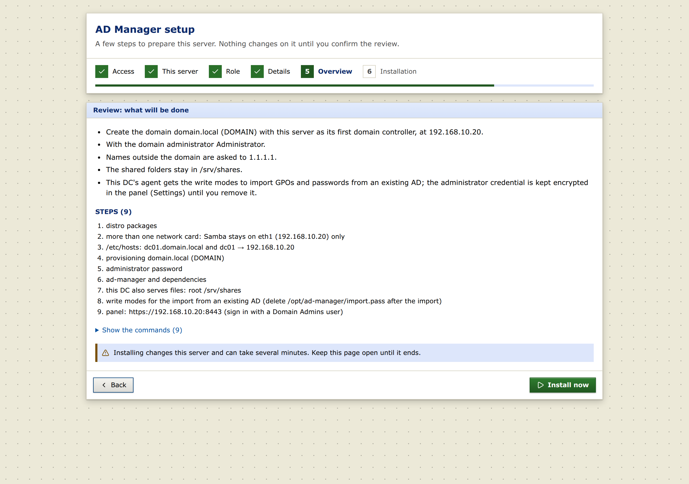
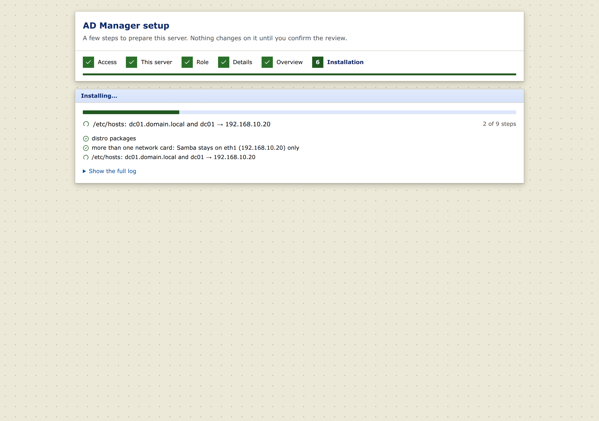
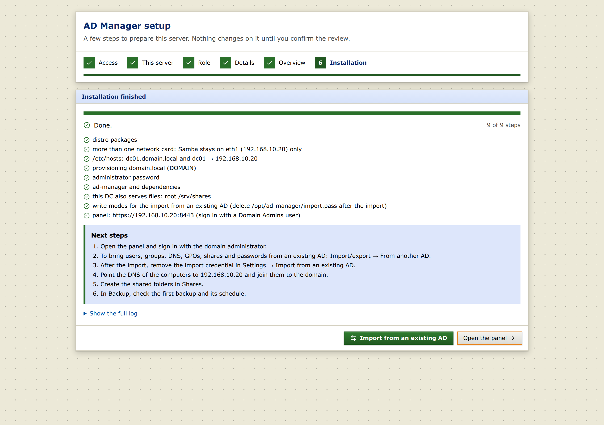

# Installation — automatic setup in the browser (recommended)

The easiest way to install AD Manager is to let it set the server up for you. Install the `.deb` on an Ubuntu 26.04
server, enable the services and open the panel: a **setup wizard** in the browser checks the machine, asks a few
questions and then does the job **automatically** — it installs and configures Samba (a new domain, an additional
DC, a restored DC or a file server) or just connects the panel to an Active Directory you already have, and writes
the configuration for you (`config.toml`, Samba's settings). Samba provisioning and domain changes only start after
you click **Install now** on the review screen.

What each role leaves running:

- **New domain, Additional DC, Restore a DC:** the panel, talking LDAPS to the DC with Samba's own CA. With
  **This DC also serves files**, also the file-server agent on the DC, already registered in the panel.
- **File server:** the agent; the local panel is switched off. The agent's token is saved once in
  `/opt/ad-manager/data/agent-token-once`: read it with `sudo cat /opt/ad-manager/data/agent-token-once`, register
  the server in the domain's panel (Shares → File servers → + new), then delete that file.
- **Connect only:** the panel, connected to the existing AD (the wizard checks that the DC is reachable; a private
  CA may need its certificate configured — `ad.ca_file`, see [deployment.md](deployment.md)).

If Samba is already on the server, it is backed up (`samba-files` backup, shown on the Backup screen) before any
change.

```bash
sudo apt install ./ad-manager_X.Y.Z_amd64.deb redis-server
sudo systemctl enable --now ad-manager ad-manager-agent
sudo cat /opt/ad-manager/data/setup-token
```

Open `https://<server IP>:8443` (self-signed certificate generated by the package) and enter the token. The token is
valid for 24 hours, accepts 5 attempts every 15 minutes and stops working when the setup finishes.

## The wizard, step by step

| 1. Access — the token from the terminal | 2. This server — automatic diagnostics |
|---|---|
|  |  |

| 3. Role — what this server should be | 4. Details — validated when you click Review |
|---|---|
|  |  |

| 4. Details — ready | 5. Review — preview of the planned steps, before installing |
|---|---|
|  |  |

| 6. Installing — live progress (full log one click away) | Done — next steps |
|---|---|
|  |  |

## Import from an existing AD

Replacing an existing domain with a new one (a new-domain cutover)? The **New domain** setup ends with **Import from
an existing AD**: after you sign in as the domain administrator it opens *Import/export → From another AD*, the same
import as later in the panel — users, groups, OUs, computers, DNS, GPOs, shares and passwords, with the source's URL,
user and password typed in that form (nothing of the source is kept by the setup).

Objects and DNS need nothing else. **GPOs and passwords** go through this DC's agent in its two write modes
([gpo.md](gpo.md), [password-migration.md](password-migration.md)): tick **Prepare the import of GPOs and passwords**
in *Details* (shown with *This DC also serves files*) and the setup turns both on (`import_modes = true` in the
agent's `[agent]`, no secret on the DC) and keeps the administrator credential **encrypted in the panel's database**
(*Settings → Import from an existing AD*, where you can change or remove it); the panel sends it to the agent with each
GPO task. The agent restarts with them a few seconds after the end of the setup. A source profile saved in *From
another AD* keeps its password encrypted too, so using the profile again needs no password. When the import is done,
remove the credential in Settings and turn the modes off:

```bash
sudo sed -i '/^import_modes *=/d' /opt/ad-manager/config.toml && sudo systemctl restart ad-manager-agent
```

Prefer doing it by hand? Every component from the `.deb` or the binary, with upgrade and removal, is in the
[installation guide](install-guide.md). The same installation from the command line is in [samba-install.md](samba-install.md)
(`scripts/samba-setup.py`), and installing and configuring the panel manually against an existing AD is in
[deployment.md](deployment.md).

## How it works

- The package installs a `config.toml` with `setup = true`: the panel serves **only the wizard** (all other routes
  return 503) and the agent opens **only a local server** on `127.0.0.1:9444`, protected by a key in
  `/opt/ad-manager/data/setup-agent.key` (root:ad-manager 0640).
- The wizard shows the diagnostics (packages, Samba role, ports, clock, disk, services), the chosen role and a
  **review** (the `samba-setup.py --dry-run` of the plan). When it runs, the agent:
  1. backs up `/etc/samba`, `/var/lib/samba` and `/etc/krb5.conf` when they exist;
  2. runs `scripts/samba-setup.py` as a transient unit (`systemd-run`), outside the agent's sandbox, with the
     administrator password on standard input (0600 file in `/run`, deleted at the end) — never as an argument;
  3. writes the log to `/var/log/ad-manager/setup-<date>.log` (password and agent token masked) and shows it live.
- `samba-setup.py` writes the final `config.toml` (without `setup`), and the panel restarts already configured.

## Roles

| Role | What it does |
|---|---|
| New domain | `samba-tool domain provision` (random password at provisioning, replaced with the chosen one through the Samba API), internal DNS, panel with validated LDAPS |
| Additional DC | joins an existing domain (Windows or Samba) as a DC, panel |
| Restore a DC | on a new machine, from a DC backup made by the panel (file copied to the server): the domain comes back with this server as the only DC, with the panel (`docs/backup.md`) |
| DC + files | "This DC also serves files" option in New domain, Additional DC or Restore a DC: share root, `registry shares = yes`, agent on the DC itself registered in the panel (`docs/dc-file-server.md`) |
| File server | joins as a member, Windows ACLs (`acl_xattr`), shares in the registry, agent |
| Connect only | writes the panel configuration for an AD that already exists (LDAPS URL and certificate) |

Running it again skips what is already done (packages, already provisioned domain). If something fails, nothing
else runs: fix it and run again, or restore the backup made before the setup.

