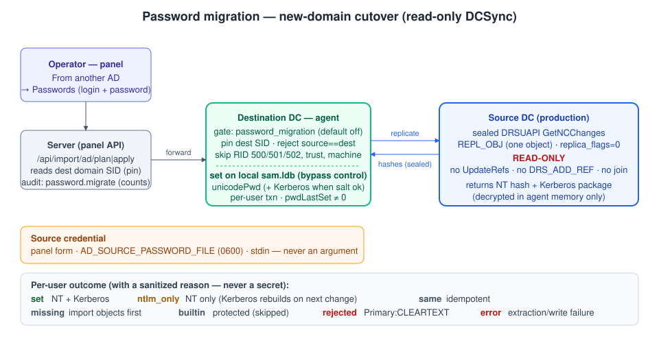

# Password migration (new-domain cutover)

Migrating a Windows DC to Samba by the **"From another AD" import** builds a **new domain** — the same realm name
but a new SID — and copies the objects in over LDAP. LDAP never exposes the password hashes (`unicodePwd` and
`supplementalCredentials` are write-only), so without this feature every user would get a generated password with
"change at next sign-in", breaking LDAP/Kerberos applications (Gitea and the like) until each user changes it.

The **password migration** preserves the production passwords: the destination DC's agent reads the source's
password hashes over directory replication and sets them on this domain's matching users. It is an optional step of
the new-domain cutover only — a `dc-join` already replicates the hashes.



## What it does

- **Extraction (source, read-only).** The agent performs a sealed DRSUAPI `GetNCChanges` with the per-object
  extended op (`REPL_OBJ`) for each requested user, decrypts the material in memory, and keeps only the NT hash and
  the Kerberos package. It **never** sets `DRS_ADD_REF`, calls `UpdateRefs`, or runs any join/provision step — the
  source's directory is left unchanged. It uses Samba's own `samba.drs_utils`/`drsuapi` bindings on the DC; no
  vendored `impacket`.
- **Setting (destination, local).** For each matching user (by `sAMAccountName`) the agent sets `unicodePwd` from
  the NT hash — and, when the Kerberos keys transfer, `supplementalCredentials` — on the local `sam.ldb` through
  Samba's password bypass control, one atomic transaction per user, with `pwdLastSet` non-zero (no "must change").
  The write is local; it never goes over LDAP.

### Why the NT hash transfers but Kerberos may not

The NT hash is `MD4(UTF-16LE(password))` — unsalted and SID-independent — so it transfers to any domain. The
Kerberos keys are **not** derivable from it: they are copied as stored, with each principal's own salt and key
types, and only when the salt convention transfers to the new domain (same realm). Where it does not, the user is
set **NTLM-only**; Kerberos keys rebuild on the next password change.

## Per-user outcome

| Outcome | Meaning |
|---|---|
| `set` | NT hash **and** Kerberos keys set — NTLM and Kerberos work with the production password. |
| `ntlm_only` | NT hash set; Kerberos keys not transferred (no Kerberos package, a non-matching salt, or Samba rejected the copied blob). NTLM/LDAP/Gitea work with the production password; Kerberos rebuilds on the next change. |
| `same` | Already migrated — the NT hash matches, `pwdLastSet` is non-zero and there are no stale Kerberos keys (the apply is idempotent). |
| `missing` | No matching user in this domain — import the objects first; no user is created. |
| `builtin` | `Administrator` (RID 500), `Guest` (501), `krbtgt` (502), a trust or a machine account — never migrated, by RID/SID on both sides. |
| `rejected` | The source stores a reversible/cleartext password (`Primary:CLEARTEXT`) — not read into the target. |
| `error` | A genuine extraction/decrypt/write failure. |

Each row carries a **sanitized reason** (shown as a tooltip in the panel, in the CLI `REASON` column, and in the
agent's journal) explaining an `ntlm_only`, `rejected` or `error` — never a hash, key, salt or password.

> **Note on `supplementalCredentials`.** Samba's write path re-serializes the Kerberos blob and requires it
> byte-identical. A legacy source blob that does not round-trip is rejected; the agent then falls back to setting
> the NT hash only (`ntlm_only`) rather than failing the user, so the production password still works.

## Running it

The gate is **off by default** and separate from the GPO-restore mode. On the destination DC's agent
(`config.toml`):

```toml
[agent]
password_migration_user          = "administrator@example.local"   # a target-domain administrator (authorization)
password_migration_password_file = "/etc/ad-manager/pwmigrate.pass" # 0600, root only; never in the config
```

With the mode on (`/api/health` reports `password_migration: true`), run it one of three ways — `plan` first (reads
no secret material), then `apply`:

- **Panel** — *Import/export → From another AD* → tick **Passwords** (beside Objects/GPOs/DNS/Shares) and run it
  with the source URL, user and password entered in that form.
- **CLI** — `ad-manager migrate passwords --from … --user … --agent https://dc:9443 [--apply]`
  (`docs/cli.md`).
- **MCP** — the `ad_password_migrate` tool (write mode only).

The source replication account needs *Replicating Directory Changes* **and** *…All*. Its password comes from the
panel form, `AD_SOURCE_PASSWORD_FILE` (a 0600 file) or stdin — **never a command argument**. The destination is
pinned by its domain SID, read through the operator's own connection (independent of the agent), and a source whose
SID equals the destination's is refused.

## What is never exposed

No plaintext is produced; the material travels only over the replication channel and the agent's local database
write. It is absent from the API responses, the server and agent logs, the audit log (`password.migrate` records
counts only) and every file on disk. The agent's helper writes only outcomes; its standard error is discarded, so a
Samba error never leaks a value.

## Order in the cutover

Objects and DNS import → **password migration** → applications tested with the real passwords. See
[migration-runbook.md](migration-runbook.md) and [cli.md](cli.md).

## Limitations

- Only for the new-domain cutover; a `dc-join` already replicates the hashes.
- Kerberos keys transfer only when the salt convention matches (same realm, unchanged `sAMAccountName`); otherwise
  the user is `ntlm_only` and the keys rebuild on the next password change.
- `krbtgt`, trust and machine-account secrets are not migrated (machines rejoin or keep their secure channel per the
  runbook); the tool never creates a user.
