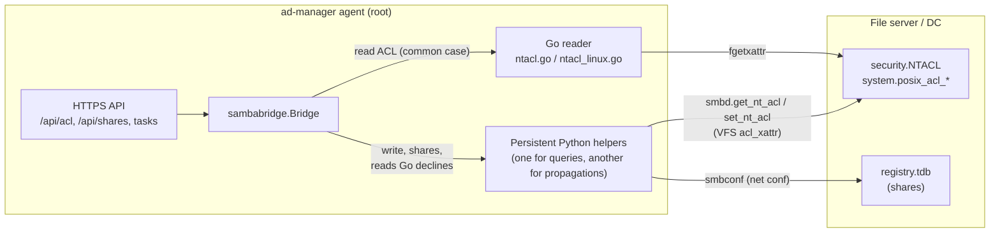
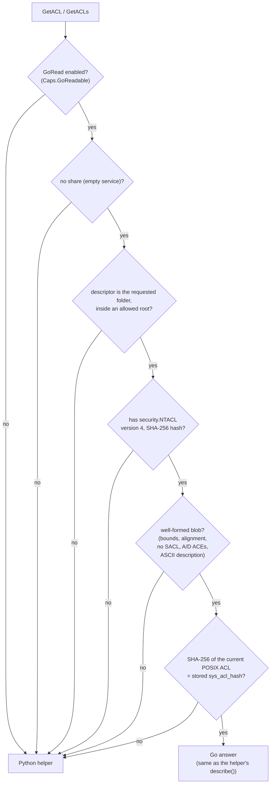
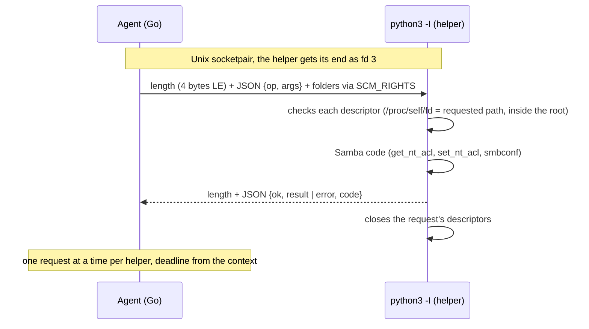

# The agent's bridge to Samba (`internal/sambabridge`)

How the agent reads and writes the **Windows permissions** (NTFS ACL) of folders and Samba's **registry shares**.
The code is `internal/sambabridge`; the study that led to this design is in [samba-api.md](samba-api.md)
and in the `openspec/specs/agent-samba` specs.

Summary:

- **Writing** (ACLs, shares) goes through Samba's own code, in a **Python helper** embedded in the binary,
  which stays up and serves one request at a time. Without `python3-samba` (bridge unavailable), folders get a
  POSIX ACL (`setfacl`) and shares go through `net conf`.
- **Reading** a folder's ACL is done **in Go** when Samba would return the stored descriptor untouched; in
  any other case, the helper answers.
- The result of both reads is **the same, byte for byte** (tested with Samba's NDR and on the lab DC).

## Where things live on the server

| What | Where | Tool to inspect it |
|---|---|---|
| Shares created by the panel | Samba registry, `/var/lib/samba/registry.tdb` (`registry shares = yes`) | `net conf list`, `testparm -s` |
| Provisioning shares (`sysvol`, `netlogon`) | `/etc/samba/smb.conf` | `testparm -s` |
| A folder's Windows ACL | the folder's `security.NTACL` xattr (NDR `xattr_NTACL` v4) | `samba-tool ntacl get <folder> --as-sddl` |
| Equivalent POSIX ACL | `system.posix_acl_access` and `system.posix_acl_default` xattrs | `getfacl <folder>` |
| ACL change history | the agent's `data/acl-history.jsonl` (`0600`) | share editing screen |

Samba stores in `security.NTACL` (version 4) a **SHA-256 hash of the POSIX ACL** as of the write. On read
(`validate_nt_acl_blob`), if the hash matches, it returns the stored descriptor. If it does not match (someone changed
the POSIX ACL from outside, with `setfacl` or `chmod`), it does a second check: it computes a descriptor from the
POSIX ACL and compares its hash with the other stored hash; if that one matches, it still returns the stored one,
otherwise it answers with the **computed** one. With `acl_xattr:ignore system acls = yes`, it returns the stored one
without checking. The Go reader only answers in the first case (the POSIX ACL hash matches); the others are left to
the helper.

## Overview



## Reading the ACL: when Go answers

Go only answers when it is certain that Samba would return **the stored descriptor** (the rule of
`validate_nt_acl_blob`, in `source3/modules/vfs_acl_common.c`). Any doubt returns `errNotMine`, and the helper
reads it.



### When the Go reader is enabled (`Caps.GoReadable`)

At startup the agent asks the helper for its capabilities (`capabilities`) and enables the Go reader only if Samba's
`[global]` has:

- `acl_xattr` in `vfs objects`, and only modules that do not change where the ACL lives: `dfs_samba4`, `acl_xattr`,
  `recycle`, `full_audit` (a DC's default is `dfs_samba4 acl_xattr`). `xattr_tdb`, `zfsacl` and others → helper only;
- `acl_xattr:security_acl_name` **not set** (set, even empty, changes the xattr Samba reads).

Reads with a `service` (a share's options may differ from `[global]`) always go to the helper.

### The POSIX ACL hash

It is the SHA-256 of `smb_acl_wrapper` in NDR (`librpc/idl/smb_acl.idl`), built like
`posix_sys_acl_blob_get_fd` (`source3/smbd/posix_acls.c`):

| Field | Source | Rule |
|---|---|---|
| `access_acl` | `system.posix_acl_access`; without the xattr, built from the mode (`user::`, `group::`, `other::`, like `acl_from_mode`) | unique pointer `0x20000` |
| `default_acl` | `system.posix_acl_default`; on a folder without it, an **empty** (not null) ACL | unique pointer `0x20004` |
| `owner`, `group` | `fstat` | 8 bytes each (`uid_t`/`gid_t` are `hyper` in NDR) |
| `mode` | `fstat`, with the type (`S_IFDIR`) | 4 bytes |
| entries | Samba tag (USER 1, USER_OBJ 2, GROUP 3, GROUP_OBJ 4, OTHER 5, MASK 6), union level, uid/gid only in USER and GROUP (8-byte aligned), permission | in xattr order |

### What Go returns

The same as the helper's `describe()`: owner, group, ACEs (SID, allow/deny, mask, flags, inherited, level
`full`/`rw`/`ro`/`custom`), protected, null DACL and the **SDDL** written like Samba's `as_sddl()` without a domain
SID (`libcli/security/sddl.c`): two-letter aliases only for well-known SIDs (`SY`, `BA`, `WD`…), mask by names
(`SDRC`), `FA`/`FR`/`FW`/`FX` when it is exactly one of them, otherwise `0x…`. Beforehand, the same normalizations as
Samba: the SACL is discarded (request without `SECINFO_SACL`) and `make_sec_desc` sets `DACL_PRESENT` when there is a
DACL.

## The persistent Python helper



Rules:

| Situation | What happens |
|---|---|
| First request, helper dead or older than 1 hour | a new helper starts (`python3 -I -s -B -c <embedded code>`, clean environment, `cwd /`) |
| ACL propagation (up to 30 min) | **separate** helper: a long walk does not make the listing wait |
| Request canceled before being sent | error, nothing sent, the helper keeps running |
| Deadline exceeded, cancellation during send/read, I/O error | the helper is **killed** (the next request starts another) |
| Write sent without a response | error "**the change may have been applied**": no automatic retry; reread the ACL and check the history |
| More than 250 folders in a batch | refused (Linux accepts 253 descriptors per message) |
| Response larger than 4 MiB | refused, helper killed |
| Windows and macOS | no helper (`ErrUnavailable`); the agent only runs on Linux |

## Tests and how to check

| Test | What it proves |
|---|---|
| `TestHelper` (`helper_linux_test.go`) | the helper stays up, comes back after being killed, after a deadline and after cancellation |
| `TestNTACLCorpus` | 126 descriptors packed by Samba's NDR (`testdata/gen_ntacl_corpus.py`) read in Go give the same `describe()`, SDDL included |
| `TestPosixACLHash` | the hash of a real folder on the lab DC matches Samba's |
| `TestNTACLRejects*`, `FuzzParseNTACL` | malformed blob, SACL, odd offset, non-ASCII description → helper; no panic |
| `TestGoReadable` | VFS stack and xattr name that disable the Go reader |
| `TestNTACLParity` (`-tags parity`, on the server) | every folder under a root read by the helper and by Go: identical where Go answers, and Go answered at least once |

Parity on a server (as root, with `python3-samba`):

```bash
go test -c -tags parity -o parity.test ./internal/sambabridge
```

```bash
sudo NTACL_PARITY_ROOT=/srv/shares ./parity.test -test.run TestNTACLParity -test.v
```

On the lab DC: 16 folders read in Go identical to Samba, 59 left to the helper (POSIX ACL changed
outside Samba or no `NTACL`) and none where Samba returned the stored descriptor and Go did not answer.

Measurements in the lab (the agent's `/api/shares`): 0.30 s with one Python process per call; 0.17 s with the
persistent helper. Reading in Go does not change that number in the lab (the rest of the time is not spent on ACLs),
but it avoids Python where folders were created by the panel.
