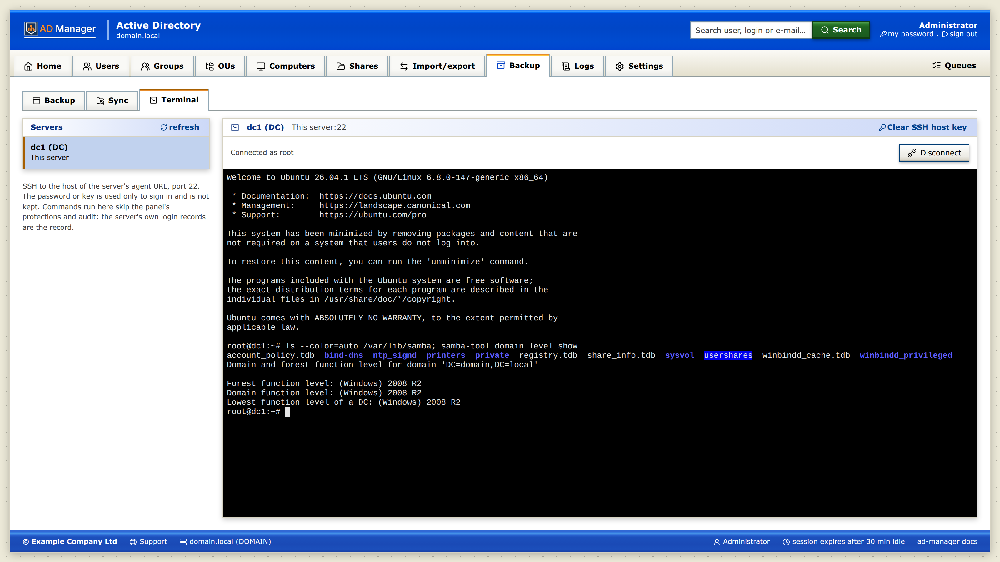

# SSH terminal

The **Terminal** sub-tab, beside **Backup** and **Sync** under the **Backup** tab, opens an SSH shell to a
registered server from the panel: pick the server on the left, enter the SSH user with a password or a private key
(with its passphrase), and **Connect**.



## Turning it on

It is **off by default**. In **Settings**, check **SSH terminal (Backup › Terminal)** and save. Turning it off
closes every open terminal at once.

> Commands run in the terminal skip the panel's protections (protected accounts, DCs, OUs…) and its audit: the
> panel records only the connection (`ssh.open`, `ssh.close`). The server's own login records (`auth.log`,
> shell history) are the record of what was done.

## How it connects

- The SSH client runs **in the panel** (Go, `golang.org/x/crypto/ssh`), not in the agent and not in the browser.
  The page talks to the panel over a WebSocket on the panel's own address; the panel dials the server.
- The target is the **host of the server's agent URL, port 22**. The panel never takes another host or port, so it
  is never an open relay. The agent URL must point at the server itself: an agent published behind a reverse proxy
  would send SSH to the proxy.
- Only signed-in administrators; at most **4 terminals per operator**. A terminal ends with the panel session
  (sign-out, idle timeout — typing counts as activity, output does not) and when the panel stops.
- The **password, key and passphrase** go only in the first message, are used to sign in and are not kept: not in
  the database, the logs, the audit or the browser's storage. The form clears once the shell opens. SSH errors are
  shown as fixed messages, never the server's text.
- The terminal is `xterm-256color` (the PTY's `TERM`) with the classic xterm palette — black background, the 16
  ANSI colors and the 256-color cube — the same in every panel theme.
- **Shift+Insert** pastes the clipboard into the terminal (the browser asks once to allow reading it).
- The desktop app does not have it (its proxy carries no WebSocket): the sub-tab shows disabled there.

## Host key

The first connection to a server shows the type and **SHA-256 fingerprint** of its SSH host key (Ed25519 when the
server has one) and asks to trust it; check it on the server with `ssh-keygen -lf /etc/ssh/ssh_host_ed25519_key.pub`
(or the `.pub` of the type shown). Once trusted it is saved for that server
(`ssh.hostkey.trust`). If the server later presents another key, the panel refuses the connection **before sending
any credential** ("The host key of … changed").

After a legitimate change (server reinstalled, keys regenerated) use **Clear SSH host key** in the Terminal sub-tab
(`ssh.hostkey.reset`); the next connection asks again. Changing the agent's URL to another host clears it too.

## Behind a reverse proxy

The WebSocket needs the `Upgrade` headers, the original `Host` (the panel compares the page's `Origin` with it) and
an idle timeout above 30 s (the panel pings every 30 s).

```nginx
location / {
    proxy_pass https://127.0.0.1:8443;
    proxy_http_version 1.1;
    proxy_set_header Host $host;
    proxy_set_header X-Forwarded-For $proxy_add_x_forwarded_for;
    proxy_set_header Upgrade $http_upgrade;
    proxy_set_header Connection $connection_upgrade;  # map $http_upgrade $connection_upgrade { default upgrade; '' close; }
    proxy_read_timeout 120s;
}
```

Caddy passes `Host` and WebSocket upgrades by default:

```caddyfile
panel.example.com {
    reverse_proxy https://127.0.0.1:8443 {
        transport http {
            tls_insecure_skip_verify
        }
    }
}
```

## API

`GET /api/agents/{id}/ssh` (WebSocket) and `DELETE /api/agents/{id}/ssh/hostkey`, documented at `/swagger`.
