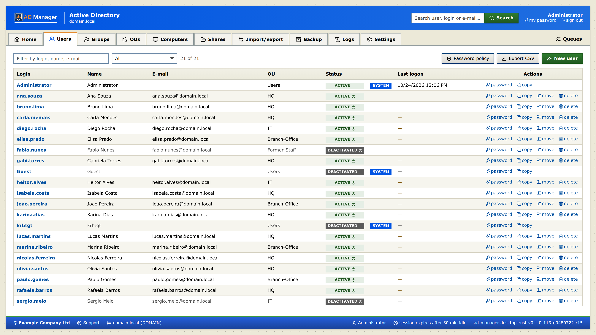
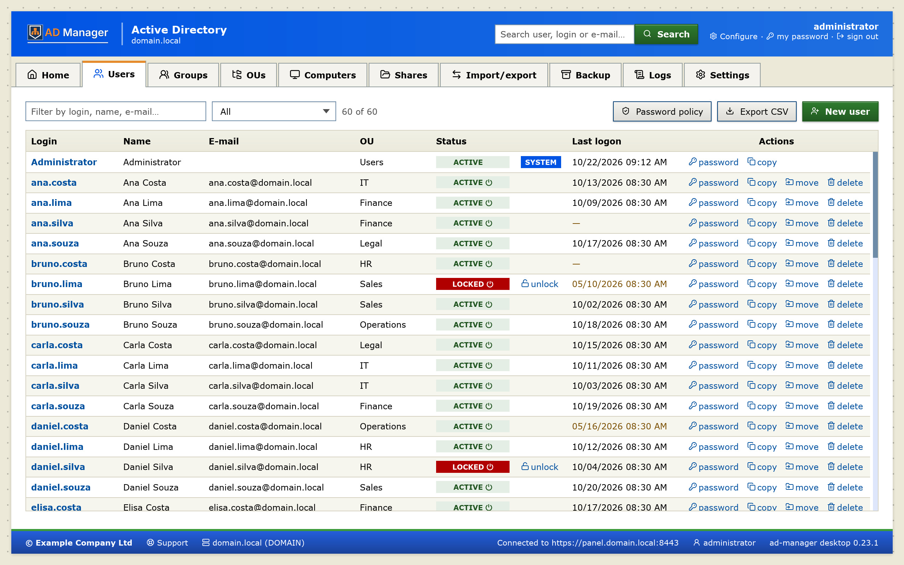
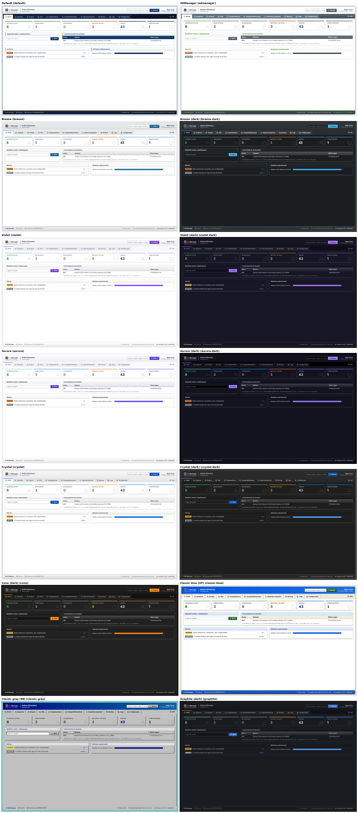
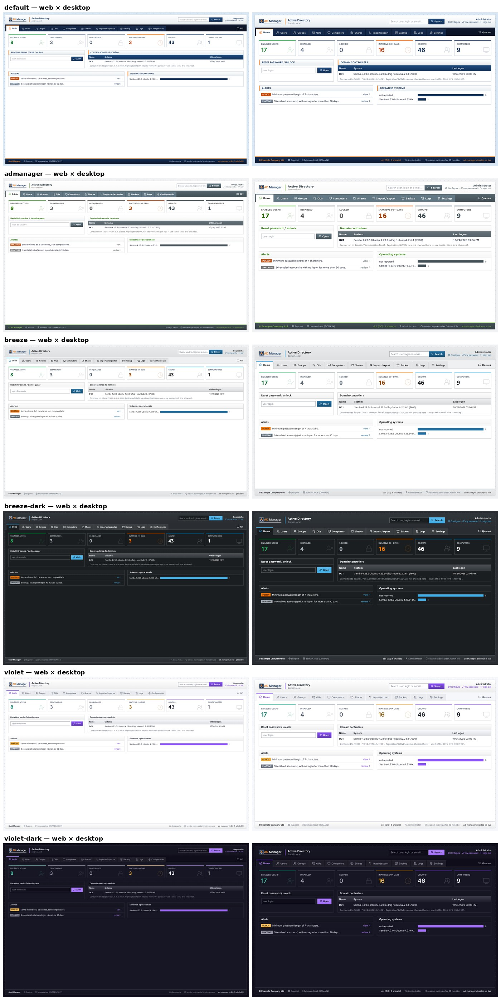
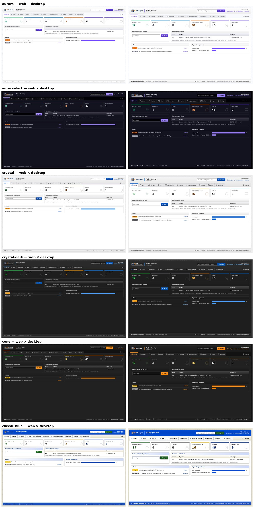
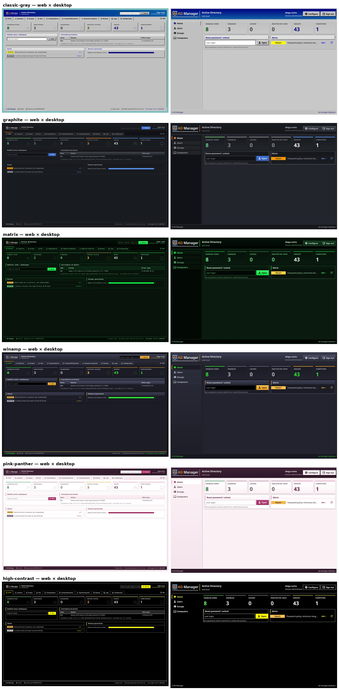

# Default theme — web panel and desktop app

A guide to carrying the AD Manager look (the **Default** theme) over to another system: navy blue with an orange
accent, **square corners everywhere**, subtle depth (short gradients and small shadows) and a dense interface
(12–13 px text).

| Web panel | Desktop app |
|---|---|
|  |  |

## 1. Colors

| Token | Hex | Use |
|---|---|---|
| `cn` (navy) | `#113058` | main color: buttons, table header, links, selection |
| `cn-dark` | `#0e172d` | bar background (menu, footer), button borders, end of gradients |
| `cn-light` | `#1d4a7e` | start of navy gradients, hover |
| `cn-accent` | `#f58322` | orange: strip under the header, active tab, focus, card bar |
| `cn-accent-strong` | `#fe6101` | link/action hover and orange button hover |
| `cn-muted` | `#69788b` | labels, secondary text |
| `cn-soft` | `#8b9aad` | disabled, dimmed icons, checkbox border |
| `cn-bg` | `#d9e6f3` | page background and zebra row |
| `cn-bg-light` | `#e7ecef` | login background and desktop content background, modal footer |
| `cn-bg-soft` | `#eaf0f6` | row hover, secondary button background |
| `cn-border` | `#b9c9dc` | card, table and field borders |
| `cn-ok` | `#2fa14f` | success |
| `cn-err` | `#c62828` | error, locked, danger button |
| `cn-warn` | `#ef6c00` | warning |

"Active/ok" tag: background `#d9ecd9`, text `#1f5c2a`. Selected row (desktop): `#fde3cc`.

Font: **Inter** 400 and 600 (embedded woff2, no Google Fonts); fallback `Tahoma, Verdana, Arial, sans-serif`.
The desktop app (Rust) uses the same font list as each theme.

## 2. Theme rules

- **Radius 0** everywhere (web: global `border-radius: 0 !important`; desktop: every corner radius 0).
- Workspace background with a **dot pattern**: `radial-gradient(rgba(17,48,88,.35) 1px, transparent 1px)` on a
  22 px grid over `cn-bg` (web) or `cn-bg-light` (login).
- A **3 px orange strip** separates headers (app top, modal, footer) from the content.
- Dark bars use a `cn` → `cn-dark` gradient; buttons and table headers, `cn-light` → `cn`.
- Nothing native from the browser/system shows: scrollbar, focus, select, checkbox, tooltip and validation messages
  are redrawn in the theme.
- Interface text in English with translation (pt-BR by default); dates in the language's format.

## 3. Web panel (Vue 3 + Tailwind 4)

### Copy

1. The whole `frontend/src/style.css` — tokens (`@theme`), fonts, large-screen zoom, components and native controls.
2. `frontend/src/assets/fonts/inter-latin-{400,600}-normal.woff2`.
3. `frontend/src/native.js` — theme tooltip (`title=` becomes `.theme-tip`, only when the text is truncated) and
   validation bubbles become a red border + toast. Call `installNativeReplacements()` in `main.js`.
4. `frontend/src/toasts.js` + `components/Toasts.vue`, `components/Modal.vue`, `dialogs.js` + `components/PanelDialogs.vue`
   (themed confirm/alert, instead of `confirm()`/`alert()`).
5. The `App.vue` shell (header, menu, `<main>`, footer and the page transition) and `pages/Login.vue`.

### Ready-made classes

| Class | What it is |
|---|---|
| `.btn` | navy primary button with gradient, short shadow, "sinks" 1 px on click (h 28 px, 12 px, bold) |
| `.btn-ghost` | secondary button white → `cn-bg-soft`, `cn-border` border |
| `.btn-danger` | red button (delete) |
| `.inp` | 28 px field/select; focus with navy border + halo; `select.inp` has an arrow and a themed open list |
| `.lbl` | 11 px label, uppercase, `cn-muted` |
| `.grid-t` | table: sticky navy header, `cn-bg` zebra, `cn-bg-soft` hover, 12 px |
| `.act` | inline action (link with icon), orange hover |
| `.tag` | 10 px uppercase tag; color through utilities (`bg-cn text-white`, `bg-cn-err text-white`…) |
| `.card` / `.card-h` | white card with shadow; header with a 4 px orange bar on the left |
| `dialog.pnl` + `.pnl-head/.pnl-body/.pnl-foot` | modal: navy header with orange strip, light footer, 10% from the top |
| `#toasts .toast(.err/.warn)` | notices in the top-right corner, green/red/orange |
| `.theme-tip` | `cn-dark` tooltip with an orange border on the left |

Example:

```html
<div class="card">
  <div class="card-h"><Users :size="14" /> Users</div>
  <table class="grid-t">…</table>
</div>
<label class="lbl" for="n">Name</label>
<input id="n" class="inp" />
<button class="btn"><Check :size="14" /> Save</button>
<button class="btn-ghost">Cancel</button>
<span class="tag bg-[#d9ecd9] text-[#1f5c2a]">active</span>
```

### Layout

- "Card" window: `mx-auto my-4 w-[calc(100%-32px)] max-w-[1840px] h-[calc(var(--view-h)-32px)]` with shadow
  `0 0 12px rgba(0,0,0,.5)`; **the page does not scroll**, only `<main>` (and lists inside it).
- White → `cn-bg-light` header with logo, title with an orange border on the left, search and operator.
- Menu: `cn-dark` → `#0a1222` bar; active tab with navy gradient, orange icon and 3 px orange underline
  (`shadow-[inset_0_-3px_0_var(--color-cn-accent)]`).
- Footer: `cn` → `cn-dark` gradient, 3 px orange top border, 11 px text.
- Page change: fades out in 0.15 s and comes in rising 6 px (`<transition name="page" mode="out-in">`), disabled with
  `prefers-reduced-motion`.
- Icons: `lucide-vue-next`, 14–15 px.
- Large screens: `zoom` 1.25 (≥ 2400 CSS px) and 1.6 (≥ 3200 px); use `calc(var(--view-h) - X)` instead of `100dvh`.

### Login

Webmail measurements (Roundcube, company skin): 580 px form 10% from the top, 480 × 267 px navy box with a
4 px orange top border, 195 × 65 logo, 41 px rows, 326 × 25 fields, orange `#f58322` button (hover
`#fe6101`), elliptical `login_shadow.png` shadow below and errors/hints **outside** the box. The same component serves
public pages (e.g. the password change link).

## 4. Desktop app (Rust + egui)

The desktop app (`desktop/`) draws the web's themes from `crates/core/assets/themes.json`, generated from the
same CSS (`make desktop-themes`; `make desktop-check` fails when it is out of date):

| File | What it has |
|---|---|
| `crates/ui/src/style.rs` | the theme → egui visuals: colors, fonts, control sizes, the flat look |
| `crates/ui/src/depth.rs` | the web's gradients (in their CSS color space) and box-shadow layers, outer and inset |
| `crates/ui/src/widgets.rs` | buttons, fields, tags, cards (`panel`), tabs, the refresh and saving spinners |
| `crates/ui/src/table.rs` | the web's `.grid-t` table: sticky header, zebra, truncation as the browser's ellipsis, tags |
| `crates/ui/src/modal.rs` | the web's dialogs: header strip (red when destructive), footer band, typed confirmations |
| `crates/ui/src/shell.rs` | header, top tabs, footer and the page pattern |

The archived Fyne app (`archive/desktop-go/`, code only) has its own notes in its sources.

## 5. Checklist for a new app

- [ ] Color tokens and Inter font copied; global radius 0.
- [ ] Dotted background, orange strip under the header, navy footer.
- [ ] `.btn`/`.btn-ghost`/`.btn-danger` buttons (web) or `widgets::button` (desktop) — no system buttons.
- [ ] Tables with a sticky navy header and zebra; `.tag` tags with a fixed width per column.
- [ ] Themed modals, 10% from the top; confirm deletion by typing the name.
- [ ] Native controls redrawn (`native.js`, select, checkbox, scrollbar, orange focus).
- [ ] Login with the webmail measurements; language chosen at login.
- [ ] Check in Full HD, QHD (zoom 1.25) and 4K (zoom 1.6), in Chrome and Firefox.

## 6. Selectable panel themes

The web panel has 18 themes, chosen in **Settings → Theme** (applies to every operator and to the login
screen). The default is **Default**; the desktop app uses the same themes.
The **Flat look** checkbox removes gradients and shadows from any theme.

| Theme | Id | Scheme | Reference |
|---|---|---|---|
| Default | `default` | light | this guide |
| ADManager | `admanager` | light | inspired by ManageEngine ADManager Plus (no affiliation) |
| Breeze / Breeze (dark) | `breeze`, `breeze-dark` | light / dark | KDE Breeze |
| Violet / Violet (dark) | `violet`, `violet-dark` | light / dark | DashboardPack's violet dashboard |
| Aurora / Aurora (dark) | `aurora`, `aurora-dark` | light / dark | DashboardPack's gradient dashboard |
| Crystal / Crystal (dark) | `crystal`, `crystal-dark` | light / dark | macOS system colors |
| Cone (dark) | `cone` | dark | VLC 4 dark interface |
| Classic blue (XP) | `classic-blue` | light | Windows XP (Luna) |
| Classic gray (98) | `classic-gray` | light | Windows 98, with 3D bevels |
| Graphite (dark) | `graphite` | dark | Grafana 11 |
| Matrix (dark) | `matrix` | dark | the film's green phosphor terminal: monospace, a static "digital rain" of strokes on the page, a soft green glow |
| Winamp (dark) | `winamp` | dark | the Winamp 2 skin: brushed steel with a 1 px bevel, LCD readout (green on black) in fields, amber buttons, the playlist's blue selection |
| Pink Panther | `pink-panther` | light | the 1963 film titles: plum title bars with the panther-pink stripe, blush page, deep rose actions; pink only as an accent |
| High contrast (dark) | `high-contrast` | dark | accessibility: black and white, one yellow accent, 3 px focus ring, no gradients or depth shadows (WCAG AAA); Matrix's structure (window line, bars, tab marks) in that palette |

All have square corners and pass the WCAG contrast matrix (`frontend/src/themes/matrix.json`); Crystal, Crystal
(dark) and High contrast are held to AAA (normal text 7:1). Reference colors
adjusted for contrast are noted in the header comment of each theme file. In dark themes (and
in those with a dark header) the product logo switches to the light-ink version, and the customer logo gets a
light plate behind it.



### Web × desktop

The desktop app uses the same colors, gradients, shadows, fonts and page pattern (generated from the theme files) and
the same roles in each part — header, top tabs, inner tabs, card titles, table header, buttons, dialogs, focus ring
and login. In the flat look, decorative gradients, shadows and bevels disappear on both sides; only the state markers
remain (current tab, selected item, focus, invalid field). Accepted differences: the language choice at the web login
× "Configure" on the desktop, the browser's blur behind dialogs, toasts (the desktop uses its status line and dialogs)
and the native file inputs. The visual suite (Playwright) runs locally with `scripts/visual-ci.sh`, outside CI. The
mosaic below is the web home screen (visual suite, `BASELINE=1 npx playwright test`) next to the desktop's (its live
test against the all-in-one test image, `ADM_LIVE_SHOTS`; how-to in [screenshots/README.md](screenshots/README.md)).




